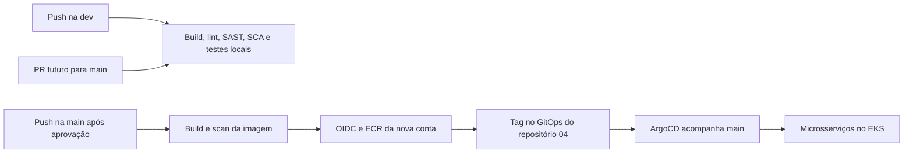

# ToggleMaster — Tech Challenge Fase 4

O ToggleMaster é uma plataforma de feature flags composta por cinco microsserviços. A Fase 4 acrescenta observabilidade e resposta a incidentes à base de Terraform, CI/CD e GitOps construída na Fase 3.

**Estado em 2026-10-20:** código e histórico da Fase 3 importados; requisitos, cinco guias e plano de implementação preservados. A nova conta AWS ainda está em preparação. A instrumentação e a stack de observabilidade da Fase 4 continuam pendentes; não há implantação nova comprovada.

Repositório: [fiap-devops-arqcloud-2026/tech-challenge-04](https://github.com/fiap-devops-arqcloud-2026/tech-challenge-04). A base importada é o commit [6100879 da Fase 3](https://github.com/fiap-devops-arqcloud-2026/tech-challenge-03/commit/61008794090f582c098e2edc42041339c556f14c), com histórico preservado. O repositório 03 não foi alterado.

## Requisitos, estudos e situação da entrega

- [Requisitos oficiais mapeados](docs/requisitos/README.md): 42 obrigatórios, 2 opções/preferências chamadas de bônus e 4 sugestões, com evidências por página. O PDF não promete pontos extras.
- [Requisitos em HTML](docs/requisitos/REQUISITOS.html): leitura local e navegação pelos selos dos guias.
- [Enunciado da Fase 4](POSTECH%20-%20Tech%20Challenge%20-%20Fase%204.pdf).
- [Welcome](docs/aulas-fiap/00.Welcome%20to%20Observabilidade%20e%20Monitoramento/GUIA-ESTUDO-Welcome-to-Observabilidade-e-Monitoramento.html).
- [Observabilidade e Monitoramento](docs/aulas-fiap/01.Observabilidade%20e%20Monitoramento/GUIA-ESTUDO-Observabilidade-e-Monitoramento.html).
- [Monitoramento Opensource](docs/aulas-fiap/02.Monitoramento%20Opensource/GUIA-ESTUDO-Monitoramento-Opensource.html).
- [APM](docs/aulas-fiap/03.APM/GUIA-ESTUDO-APM.html).
- [Automação de incidentes](docs/aulas-fiap/04.Automa%C3%A7%C3%A3o%20de%20incidentes/GUIA-ESTUDO-Automacao-de-incidentes.html).

Os materiais originais da Fase 4 foram mantidos. Os guias abrem diretamente no navegador. A validação estrutural e as referências não substituem evidência do sistema funcionando.

O prazo de planejamento informado pelo responsável é **2026-11-17**; essa data não consta no PDF. Vídeo de até 25 minutos e relatório PDF serão produzidos após a demonstração funcional. Ainda não há links finais de vídeo/relatório da Fase 4.

## O que foi reaproveitado e o que falta

| Área | Base importada | Trabalho da Fase 4 |
|---|---|---|
| Aplicação | auth/evaluation em Go; flag/targeting/analytics em Python | Instrumentar os cinco serviços e propagar contexto de trace |
| Local | Compose, PostgreSQL, Redis, Moto para SQS/DynamoDB e teste ponta a ponta | Adicionar Collector local e validar telemetria no New Relic |
| Infraestrutura | Terraform em três camadas e cluster EKS | Confirmar nova conta, orçamento/cotas e provisionar estados próprios |
| CI/CD | Build, lint, SAST, SCA e scan de imagem | Destino ajustado ao repo 04; configurar variáveis da nova conta antes de publicar |
| GitOps | ArgoCD/Kustomize e 23 objetos Kubernetes | Publicar imagens/outputs novos e adicionar observabilidade por Helm/GitOps |
| Observabilidade | Arquitetura planejada | Prometheus, Loki, Grafana, OTel Collector e APM New Relic |
| Incidentes | Arquitetura planejada | Alerta, PagerDuty, Slack e Self-Healing por GitHub Actions |

As escolhas New Relic, Slack e GitHub Actions foram definidas no planejamento. Os estudos e o plano não significam que esses recursos já estejam configurados.

## Serviços e arquitetura da base

| Serviço | Porta local | Responsabilidade |
|---|---|---|
| auth-service | 8001 | Chaves e autenticação de serviços |
| flag-service | 8002 | Cadastro de feature flags |
| targeting-service | 8003 | Regras de segmentação |
| evaluation-service | 8004 | Avaliação de flags e envio de eventos |
| analytics-service | 8005 | Consumo de eventos e persistência analítica |



O diagrama descreve o fluxo preparado, não uma execução remota já comprovada. O trabalho atual fica na **dev**. A main não recebeu esta importação, e não foi aberto PR nem feito push. Publicação de imagens e atualização automática de tags continuam reservadas a push na main; dev/PR validam código sem autenticar na AWS.

## Executar e validar localmente

Pré-requisitos: Docker com engine Linux ativo; para o teste automatizado, Bash e Python 3. O teste usa somente valores fictícios do `.env.example` e Moto local, sem credenciais ou recursos AWS.

```bash
# Constrói os contêineres, aguarda health checks e testa o fluxo dos cinco serviços.
bash scripts/test-compose.sh
```

O projeto Compose padrão do teste é `tc04-integration`, separado de outros laboratórios. O script não remove o ambiente ao terminar. Para remover somente os contêineres e volumes descartáveis criados por esse teste, use a mesma identidade de projeto:

```bash
# Define a identidade exclusiva do laboratório que será encerrado.
export COMPOSE_PROJECT_NAME=tc04-integration
# Encerra somente esse projeto de teste e seus volumes descartáveis.
docker compose --env-file .env.example -f docker-compose.yaml -f docker-compose.integration.yaml down -v --remove-orphans
```

Para checagens locais de sintaxe, build e composição:

```bash
# Verifica padrões de segredos, Terraform sem backend, manifests e build/sintaxe dos serviços.
bash scripts/validate-all.sh
```

Leia a saída: a ausência de ferramenta é informada pelo script e limita a verificação. `go test` pode registrar que a base não tem testes unitários; o teste integrado em Compose verifica a interação real dos serviços. Nenhum desses comandos comprova implantação na AWS.

## CI/CD e a nova conta AWS

Os cinco workflows de serviços usam dois workflows reutilizáveis. Build, lint, SAST e SCA não dependem de conta AWS. Validação Terraform e Compose também estão configurados para push na dev. Os scans mantêm a política importada de bloquear vulnerabilidades CRITICAL.

Quando a conta estiver pronta, configurar estas **repository variables** no repo 04:

| Variável | Conteúdo |
|---|---|
| `AWS_REGION` | Região confirmada; enquanto ausente, CI usa o padrão de planejamento `us-east-2` |
| `ECR_REGISTRY` | Endereço real do ECR da nova conta |
| `AWS_ROLE_ARN` | Role real com confiança OIDC autorizada ao repositório 04 |

O pipeline de publicação recusa variáveis ausentes ou destinos incoerentes antes de autenticar na AWS ou enviar imagens. Nenhuma chave AWS estática deve ser versionada.

## Terraform e ArgoCD: configuração pendente

Consulte [Terraform da Fase 4](terraform/README.md) e [GitOps da Fase 4](gitops/README.md). As camadas usam chaves próprias `phase4/prod/base.tfstate`, `phase4/prod/cluster.tfstate` e `phase4/prod/k8s.tfstate`, backend parcial e identificação obrigatória da conta esperada. Não reutilizar estado da conta anterior como estado de uma conta nova.

O ArgoCD está preparado para `https://github.com/fiap-devops-arqcloud-2026/tech-challenge-04.git`. A main é seu destino futuro; trabalhar localmente na dev não sincroniza um cluster. Imagens, IRSA e endpoints no overlay usam marcadores intencionais de conta pendente e devem ser substituídos por outputs confirmados antes de habilitar implantação. Tipos/tamanhos, versões, cotas e custos herdados precisam de revisão antes da subida.

## Documentação histórica da base

[Arquitetura](docs/ARQUITETURA.md), [guia de reprodução](docs/GUIA_DE_REPRODUCAO.md), [relatório anterior](docs/RELATORIO_DE_ENTREGA.md) e materiais da Fase 3 foram preservados para rastreabilidade. Links de evidências antigos continuam apontando ao repo 03, onde os eventos ocorreram; não são provas de execução da Fase 4 nem parâmetros para a conta nova. A configuração vigente do destino é a deste README, de `terraform/README.md` e de `gitops/README.md`.
