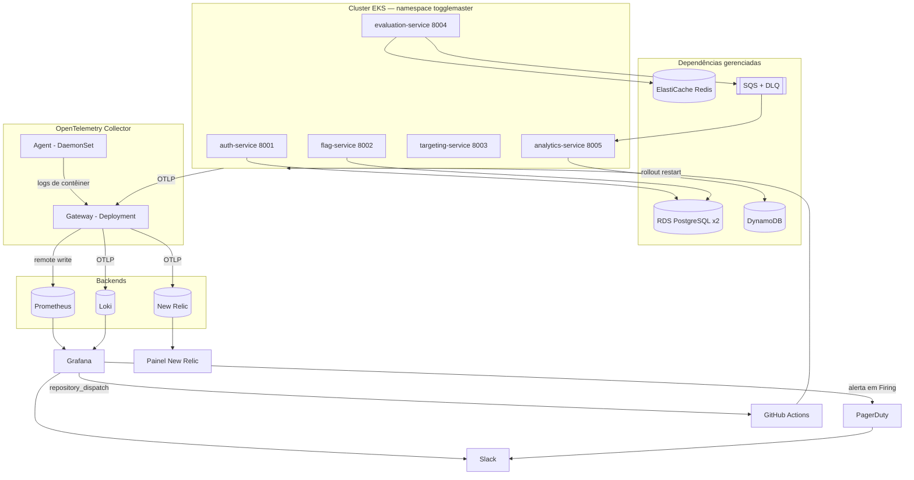
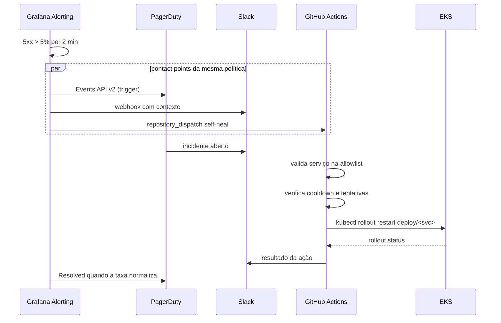

# Plano de ação e arquitetura — Tech Challenge Fase 4

TL;DR: importar a base da Fase 3 para este repositório, subir a stack de observabilidade por GitOps, instrumentar os cinco serviços com OpenTelemetry, rotear tudo por um OTel Collector (agent + gateway) para Prometheus, Loki e New Relic, e fechar o ciclo alerta → PagerDuty → Slack → self-healing por GitHub Actions. Nove etapas, das quais três podem rodar em paralelo. As decisões de ferramenta estão justificadas com verificação externa datada.

Última atualização: 2026-09-21, Claude (Opus 5). Documento de planejamento — **nada foi implementado nem comitado**.

Fonte dos requisitos: [`docs/requisitos/README.md`](../../docs/requisitos/README.md) (42 REQ-OBR, 2 REQ-BON, 4 SUG, Q-01 a Q-14).

---

## 1. Decisões de ferramenta

Cada escolha do enunciado é "uma OU outra". Abaixo, a recomendação e o porquê. As verificações externas foram feitas em 2026-09-21 e valem para essa data.

| Decisão | Recomendação | Motivo |
|---|---|---|
| APM (REQ-OBR-12) | **New Relic** | O plano gratuito do New Relic é perpétuo, inclui 100 GB/mês de ingestão, 1 usuário full e **APM com distributed tracing**, sem cartão de crédito. O plano gratuito do Datadog cobre apenas infraestrutura (até 5 hosts); **APM não está incluído** — só em teste de 14 dias ou plano pago (~US$ 31/host/mês). Um teste que expira no meio do projeto inviabiliza a regravação do vídeo. |
| Incidentes (REQ-OBR-17) | **PagerDuty** | A Atlassian encerrou a venda do OpsGenie em 2025-06-04 e desliga o produto em 2027-04-05 (F-008): não há como abrir conta nova. O plano Free do PagerDuty dá 5 usuários, 1 escala de plantão, 1 política de escalonamento, integrações de monitoramento e chat, e chamadas de API. |
| ChatOps (REQ-OBR-18) | **Slack** | Único canal citado tanto na p. 5 quanto na p. 6 do enunciado — escolhê-lo elimina a dúvida Q-02. Discord serve igualmente se o grupo já usa um servidor. |
| Coletor (REQ-BON-01) | **OTel Collector padrão** (contrib) | O enunciado nomeia o Collector no código entregue e no roteiro do vídeo (p. 5). Usar Alloy no lugar reabre a dúvida Q-10 sem ganho. |
| Instrumentação (REQ-OBR-13, REQ-BON-02) | **Bibliotecas OpenTelemetry** | Preferência explícita do PDF (p. 4) e o que alimenta o Collector de forma neutra. Evita o agente proprietário e o risco da Q-08. |
| Self-Healing (REQ-OBR-19) | **GitHub Actions por `repository_dispatch`** | É uma das três alternativas nomeadas no enunciado (p. 5), reaproveita o provedor OIDC do GitHub e a role de CI que a Fase 3 já provisiona, e o log da execução é a evidência pronta para REQ-OBR-38. |

**Verificação externa (2026-09-21):** New Relic — página oficial de preços; Datadog — comparativos de mercado sobre o plano gratuito; PagerDuty — página oficial de preços. Os planos gratuitos são condição comercial de terceiros e podem mudar; reconferir antes da gravação.

---

## 2. Estratégia de repositório

O `tech-challenge-04` hoje tem só documentação. A base de código está em `tech-challenge-03` (`fiap-devops-arqcloud-2026/tech-challenge-03`).

**Recomendação:** importar a Fase 3 para o `tech-challenge-04` preservando o histórico (`git remote add fase3 ... && git fetch fase3 && git merge --allow-unrelated-histories`, ou subtree). A entrega pede "código IaC/GitOps atualizado" no repositório da fase (REQ-OBR-20, 21, 22); manter dois repositórios obriga o avaliador a navegar entre eles.

**Pontos acoplados ao nome do repositório, que precisam ser atualizados na importação:**

| Onde | Valor atual | Ação |
|---|---|---|
| `terraform/variables.tf:168` | `fiap-devops-arqcloud-2026/tech-challenge-03` | trocar para `...-04`; é o `sub` que a role OIDC do CI autoriza — sem isso o pipeline recebe `AccessDenied` |
| `terraform/k8s/variables.tf:65` | `https://github.com/.../tech-challenge-03.git` | `repoURL` da Application do ArgoCD |
| `terraform/k8s/argocd.tf:55` | Secret `repo-tech-challenge-03` | renomear |
| `gitops/overlays/prod/kustomization.yaml` | tags `v1.0.0-<sha>` da Fase 3 | serão reescritas no primeiro push do CI |

---

## 3. Plano de ação

Nove etapas. E3, E4 e E5 são independentes entre si e podem correr em paralelo se o grupo se dividir.

### E0 — Fundação do repositório
Importar a Fase 3, atualizar os quatro pontos acoplados da seção 2, abrir a branch de trabalho, subir Terraform (`base` → `cluster` → `k8s`) e confirmar que os cinco pods sobem e o ArgoCD sincroniza.
Atende: REQ-OBR-01 a 05, 25.

### E1 — Capacidade do cluster
Hoje são 2 nós `c7i-flex.large` (2 vCPU / 4 GB cada). A stack nova acrescenta, por baixo, Prometheus, Alertmanager, Grafana, Loki, o gateway do Collector e um agent por nó. **Subir `node_group_desired_size` para 3** e revisar `requests` de CPU/memória de cada Helm release.
Risco se pular: pods `Pending` no meio da gravação.

### E2 — Stack de observabilidade por GitOps
Adicionar ao repositório GitOps os Helm charts, declarados como `Application` do ArgoCD (ou `kustomize` com `helmCharts`):

| Chart | Uso | Ajuste essencial |
|---|---|---|
| `kube-prometheus-stack` | Prometheus, Alertmanager, Grafana, node-exporter, kube-state-metrics | `prometheus.prometheusSpec.enableRemoteWriteReceiver: true` |
| `loki` (modo SingleBinary) | logs | habilitar ingestão OTLP nativa; storage em `filesystem` com PVC `gp3`, ou S3 |
| `opentelemetry-collector` (×2 releases) | um `mode: daemonset`, um `mode: deployment` | imagem `contrib` — `filelog`, `k8sattributes` e `spanmetrics` não existem na imagem `core` |

Atende: REQ-OBR-06, 07, 08, 09, 20.

### E3 — Pipelines do Collector
Detalhe na seção 5. Atende: REQ-OBR-11, 39.

### E4 — Instrumentação dos cinco serviços
Detalhe na seção 6. Atende: REQ-OBR-13, 14, 15, 21, REQ-BON-02.

### E5 — Dashboard do Grafana
Um dashboard provisionado como ConfigMap (sidecar do chart), versionado no Git, com os três painéis exigidos:

1. **Uso de recursos do cluster** — CPU e memória por nó e por namespace, de `node-exporter` e `kube-state-metrics`.
2. **Taxa de requisições por microsserviço** — vem do conector `spanmetrics`, que transforma spans em métricas RED (`rate`, `errors`, `duration`) por `service.name`. Nenhum código extra na aplicação.
3. **Logs em tempo real** — painel `Logs` com datasource Loki, `{namespace="togglemaster"}`.

Atende: REQ-OBR-10, 26.

### E6 — Alerta, incidente e ChatOps
Regra de alerta unificada do Grafana, versionada como ConfigMap:

```
Expressão:  taxa de spans com status ERROR / taxa total, por service.name, janela de 5 min
Condição:   > 0.05
for:        2m
Labels:     severity=critical, service={{ $labels.service_name }}
Anotações:  summary, description, runbook_url, dashboardUId
```

O `for: 2m` mais o agrupamento por serviço na política de notificação é o que torna o alerta "inteligente" no sentido da aula de Alert Fatigue — dispara por sintoma sustentado, não por pico isolado (Q-14 continua em aberto; a justificativa vai no relatório).

Três contact points na mesma política:
- **PagerDuty** — integração Events API v2, `dedup_key` = nome do alerta + serviço.
- **Slack** — webhook de entrada, mensagem com serviço, taxa medida, link do dashboard e do trace.
- **Webhook** — `POST https://api.github.com/repos/<org>/tech-challenge-04/dispatches`, header `Authorization: Bearer <PAT>`, `event_type: self-heal`, payload com o serviço afetado.

Atende: REQ-OBR-16, 17, 18, 29, 30, 37.

### E7 — Self-Healing
Detalhe na seção 7. Atende: REQ-OBR-19, 22, 31, 38.

### E8 — Ensaio, gravação e relatório
Matriz de evidências (SUG-01), ensaio completo, gravação de até 25 min e relatório PDF.
Atende: REQ-OBR-23, 24, 26 a 28, 32 a 36, 40, 42.

---

## 4. Arquitetura de alto nível



O ciclo se fecha: a ação corretiva age sobre o mesmo cluster que gerou o sinal.

---

## 5. Arquitetura de baixo nível — pipelines do Collector

Dois modos, um `values.yaml` cada.

### 5.1 Agent (DaemonSet, um pod por nó)

| | Componentes |
|---|---|
| Receivers | `filelog` (`/var/log/pods/*/*/*.log`, parser `container`), `kubeletstats` |
| Processors | `memory_limiter`, `k8sattributes`, `resourcedetection` (env, eks), `batch` |
| Exporters | `otlp` → `otel-gateway:4317` |

O agent só coleta o que é local ao nó e repassa. Nenhuma credencial externa fica no DaemonSet.

### 5.2 Gateway (Deployment, 2 réplicas)

| Pipeline | Receivers | Processors / connectors | Exporters |
|---|---|---|---|
| `traces` | `otlp` (4317 gRPC, 4318 HTTP) | `memory_limiter`, `k8sattributes`, `resource`, `batch`; conector `spanmetrics` | `otlp/newrelic` |
| `metrics` | `otlp`, `spanmetrics` (do conector), `prometheus` (auto-scrape) | `memory_limiter`, `resource`, `batch` | `prometheusremotewrite` → `http://prometheus-operated:9090/api/v1/write`; `otlp/newrelic` |
| `logs` | `otlp` (do agent) | `memory_limiter`, `k8sattributes`, `transform` (promove `trace_id`/`span_id` a atributos), `batch` | `otlphttp/loki` → `http://loki-gateway:3100/otlp`; `otlp/newrelic` |

Exportador do New Relic:

```yaml
exporters:
  otlp/newrelic:
    endpoint: otlp.nr-data.net:4317
    headers:
      api-key: ${env:NEW_RELIC_LICENSE_KEY}
    compression: gzip
```

A license key entra como Secret criado pelo Terraform da camada `k8s`, seguindo o contrato de `gitops/SECRETS-CONTRATO.md` — **nenhuma chave no Git**.

Duas escolhas que valem explicar no relatório (REQ-OBR-39):

- **`spanmetrics`** evita instrumentar métricas RED à mão: o painel de taxa de requisições e a regra de alerta saem dos mesmos spans que alimentam o trace distribuído. Um sinal, três usos.
- **Exportação dupla** (Prometheus/Loki *e* New Relic) é o que o enunciado pede na p. 4 — o Collector roteando "para os backends corretos" — e mantém o open source como fonte da visualização principal.

### 5.3 Cadeia de resposta



---

## 6. Instrumentação por serviço

| Serviço | Linguagem | Como instrumentar | Onde muda |
|---|---|---|---|
| `auth-service` | Go 1.25 | SDK OTel + `otelhttp` (handler e transport), `otelpgx` no pgx | código |
| `evaluation-service` | Go 1.25 | SDK OTel + `otelhttp`, `redisotel` no go-redis, **injeção manual do `traceparent` nos `MessageAttributes` da SQS** | código |
| `flag-service` | Python 3.12 | `opentelemetry-instrument` no ENTRYPOINT (Flask, requests, psycopg2) | Dockerfile |
| `targeting-service` | Python 3.12 | idem | Dockerfile |
| `analytics-service` | Python 3.12 | `opentelemetry-instrument` + **extração do `traceparent` da mensagem SQS** ao consumir | Dockerfile + código |

Variáveis comuns via ConfigMap: `OTEL_EXPORTER_OTLP_ENDPOINT=http://otel-gateway:4318`, `OTEL_SERVICE_NAME`, `OTEL_RESOURCE_ATTRIBUTES=service.namespace=togglemaster,deployment.environment=prod`.

**O detalhe que faz o Service Map ter cinco serviços:** o `analytics-service` só conversa com os outros pela fila. Sem propagar o `traceparent` nos atributos da mensagem SQS, ele aparece desconectado no mapa e o REQ-OBR-15 fica meio atendido. Com a propagação, um único `GET /evaluate` produz um trace que passa por `evaluation → flag → auth`, `evaluation → targeting → auth`, Redis, SQS e `analytics → DynamoDB`.

Logs em JSON com `trace_id` e `span_id` no mesmo evento (SUG-03) permitem sair do log no Loki para o trace no New Relic.

---

## 7. Self-Healing com limites

Workflow `.github/workflows/self-healing.yml`, gatilho `repository_dispatch: [self-heal]`:

1. Autentica por OIDC na role de CI (já existe desde a Fase 3).
2. `aws eks update-kubeconfig` — o endpoint público do cluster está habilitado e o modo de autenticação é `API_AND_CONFIG_MAP`, então basta criar uma **EKS Access Entry** com política restrita ao namespace `togglemaster`.
3. **Guardrails (SUG-04):**
   - allowlist explícita de Deployments; qualquer outro valor encerra o job com erro;
   - cooldown por anotação no Deployment (`self-heal/last-attempt`), com no máximo 1 reinício a cada 10 min e 3 por hora;
   - `kubectl rollout status --timeout=180s` — se não estabilizar, **não** tenta de novo: escala o incidente no PagerDuty.
4. Publica o resultado no Slack e deixa o log da execução como evidência.

O script fica em `scripts/self-healing/`, chamado pelo workflow — é ele o artefato do REQ-OBR-22, e roda igual na mão durante o ensaio.

---

## 8. Cenário da falha proposital

O enunciado dá exemplos soltos: alerta no `auth-service` (p. 5) e falha no `flag-service` (p. 6). Pela p. 5, a automação reage "ao alerta criado" — então a falha gravada precisa acionar o alerta configurado (Q-12).

**Cenário recomendado, coerente de ponta a ponta:** endpoint administrativo de caos no `flag-service`, protegido pela `MASTER_KEY`, que faz o serviço responder 500 numa fração das requisições. O estado vive **só na memória do processo**.

1. Gerador de carga em pod (`hey` ou `k6`) mantém tráfego em `/evaluate`.
2. `POST /admin/chaos?rate=1` no `flag-service`.
3. Taxa de 5xx sobe → alerta em Firing no Grafana (REQ-OBR-29).
4. PagerDuty abre incidente, Slack recebe a notificação (REQ-OBR-30).
5. Workflow reinicia o `flag-service`; o pod novo nasce sem o estado de caos (REQ-OBR-31).
6. Taxa normaliza, alerta resolve, PagerDuty fecha.

**Por que é honesto:** o reinício cura de verdade essa classe de falha — degradação em processo, como vazamento de memória ou estado corrompido. Não estamos fingindo que reiniciar resolve erro de configuração. Vale dizer isso no vídeo; é exatamente a ressalva que a aula de Self-Healing faz.

---

## 9. Rastreabilidade

| Etapa | REQ-OBR atendidos |
|---|---|
| E0 | 01, 02, 03, 04, 05, 25 |
| E1 | — (viabiliza E2) |
| E2 | 06, 07, 08, 09, 20 |
| E3 | 11, 39 |
| E4 | 13, 14, 15, 21 |
| E5 | 10, 26 |
| E6 | 16, 17, 18, 29, 30, 37 |
| E7 | 19, 22, 31, 38 |
| E8 | 23, 24, 27, 28, 32, 33, 34, 35, 36, 40, 41, 42 |

Os 42 obrigatórios estão cobertos. O checklist da §9 do README continua sendo o registro oficial.

---

## 10. Custo e janela de operação

Base da Fase 3, estimativa oficial de 2026-09-11: **US$ 281,03/mês** com tudo ligado (EKS US$ 73, 2 nós US$ 127, 2 RDS US$ 31, Redis US$ 12, NAT US$ 37) — cerca de **US$ 0,38/hora**. O terceiro nó da E1 soma aproximadamente US$ 0,09/hora.

Recomendação: manter `terraform/base` de pé e destruir `cluster` e `k8s` fora das janelas de trabalho, como na Fase 3. Uma janela de ensaio + gravação de 6 horas custa cerca de **US$ 3**. New Relic, PagerDuty e Slack ficam no plano gratuito.

---

## 11. Riscos

| # | Risco | Mitigação |
|---|---|---|
| R-01 | Stack nova não cabe em 2 nós | E1 antes de E2; revisar `requests` |
| R-02 | 100 GB/mês do New Relic estourados por log verboso | filtrar logs de `kube-system` no exporter do New Relic; manter o volume inteiro só no Loki |
| R-03 | Plano gratuito mudar antes da entrega | reconferir na véspera; o Collector isola a aplicação do fornecedor — trocar o APM é mudar um exporter |
| R-04 | PAT do GitHub no contact point do Grafana | token de escopo mínimo (`repo` num repositório só), em Secret criado pelo Terraform, com validade curta |
| R-05 | Sem Ingress (D-012 da Fase 3), a requisição de teste depende de `port-forward` | ensaiar o `port-forward` no roteiro; ou subir um Ingress temporário só para a gravação |
| R-06 | Trace quebrado na fronteira da SQS | tratar a propagação do `traceparent` como critério de aceite da E4, não como detalhe |

---

## 12. Pontos [INCERTO] que o plano herda

Q-01 (EKS/ArgoCD no vídeo), Q-02 (Teams), Q-04 (contas educacionais de APM), Q-08 (agente do fornecedor x bibliotecas OTel), Q-10 (Alloy), Q-11 (vídeo *ou* relatório), Q-12 (falha x alerta), Q-14 (o que é alerta "inteligente"). Todos já registrados na §10 do README. O plano adota a leitura conservadora em cada um.

---

## 13. A confirmar com o grupo

1. Importar a Fase 3 para este repositório, ou manter os dois separados.
2. APM: New Relic (recomendado) ou Datadog.
3. ChatOps: Slack (recomendado) ou Discord.
4. Divisão do trabalho — E3, E4 e E5 rodam em paralelo.
5. Onde este documento deve morar em definitivo: `docs/ARQUITETURA.md`, como na Fase 3, exige autorização de caminho.
