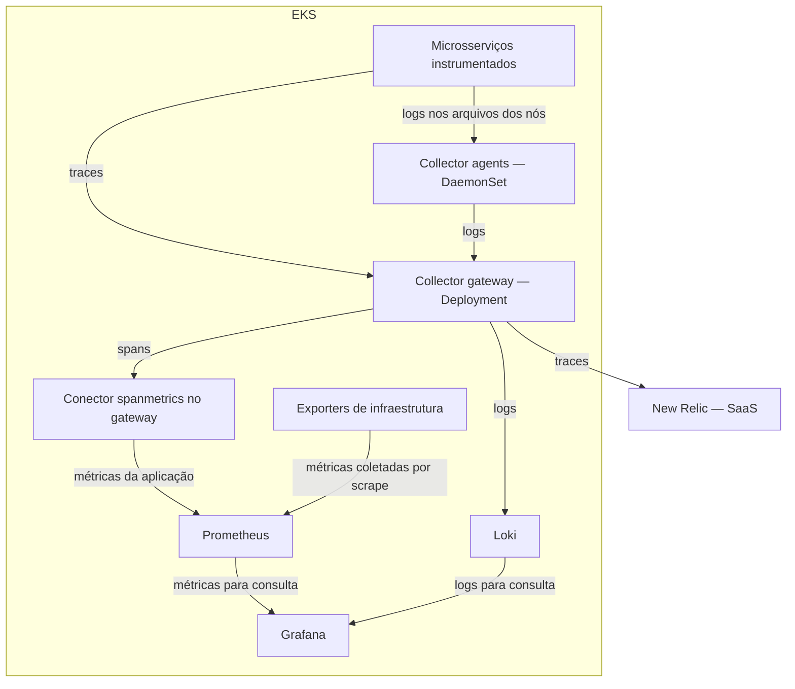
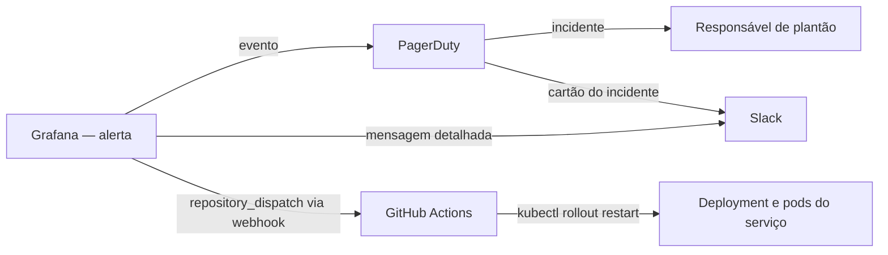
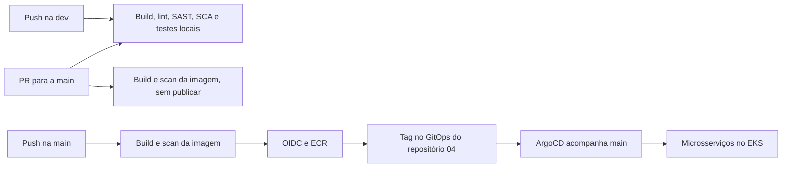

# ToggleMaster — Tech Challenge Fase 4

O ToggleMaster é uma plataforma de feature flags composta por cinco microsserviços. A Fase 4 acrescenta observabilidade e resposta a incidentes à base de Terraform, CI/CD e GitOps construída na Fase 3.

**Última atualização: 2026-11-09.** A Fase 4 está configurada neste repositório e testada localmente: instrumentação dos cinco serviços, stack de observabilidade por GitOps, dashboard, alerta, PagerDuty, Slack e self-healing. A prova da cadeia completa no EKS é apresentada no vídeo e no relatório da entrega.

Repositório: [fiap-devops-arqcloud-2026/tech-challenge-04](https://github.com/fiap-devops-arqcloud-2026/tech-challenge-04). A base importada é o commit [6100879 da Fase 3](https://github.com/fiap-devops-arqcloud-2026/tech-challenge-03/commit/61008794090f582c098e2edc42041339c556f14c), com histórico preservado.

## Requisitos e estudos

- [Requisitos oficiais mapeados](docs/requisitos/README.md): 42 obrigatórios, 2 opções/preferências chamadas de bônus e 4 sugestões, com evidências por página. O PDF não promete pontos extras.
- [Requisitos em HTML](docs/requisitos/REQUISITOS.html): leitura local e navegação pelos selos dos guias.
- [Enunciado da Fase 4](POSTECH%20-%20Tech%20Challenge%20-%20Fase%204.pdf).
- [Welcome](docs/aulas-fiap/00.Welcome%20to%20Observabilidade%20e%20Monitoramento/GUIA-ESTUDO-Welcome-to-Observabilidade-e-Monitoramento.html).
- [Observabilidade e Monitoramento](docs/aulas-fiap/01.Observabilidade%20e%20Monitoramento/GUIA-ESTUDO-Observabilidade-e-Monitoramento.html).
- [Monitoramento Opensource](docs/aulas-fiap/02.Monitoramento%20Opensource/GUIA-ESTUDO-Monitoramento-Opensource.html).
- [APM](docs/aulas-fiap/03.APM/GUIA-ESTUDO-APM.html).
- [Automação de incidentes](docs/aulas-fiap/04.Automa%C3%A7%C3%A3o%20de%20incidentes/GUIA-ESTUDO-Automacao-de-incidentes.html).

Os guias abrem diretamente no navegador. O vídeo de até 25 minutos e o relatório PDF são publicados ao final da entrega, e os links entram nesta seção.

## Onde está cada requisito da Fase 4

| Requisito | Onde está |
|---|---|
| Prometheus, Loki e Grafana por Helm, no repositório GitOps | [`gitops/observability/applications`](gitops/observability/applications) e [`values`](gitops/observability/values) |
| Dashboard customizado: recursos do cluster, requisições e logs | [`togglemaster-overview.json`](gitops/observability/grafana/dashboards/togglemaster-overview.json) |
| OTel Collector como peça central | [`otel-gateway.yaml`](gitops/observability/values/otel-gateway.yaml) e [`otel-agent.yaml`](gitops/observability/values/otel-agent.yaml) |
| APM comercial e instrumentação | New Relic, pelo gateway; `telemetry.py` e `telemetry.go` em cada [serviço](services) |
| Alerta inteligente | [`rules.yaml`](gitops/observability/grafana/alerting/rules.yaml): 5xx do flag-service acima de 10% por 1 minuto |
| PagerDuty e Slack | [`contactpoints.yaml`](gitops/observability/grafana/alerting/contactpoints.yaml) e [`policies.yaml`](gitops/observability/grafana/alerting/policies.yaml) |
| Self-healing | [`self-healing.yml`](.github/workflows/self-healing.yml), [`restart.sh`](scripts/self-healing/restart.sh) e [`self-healing-rbac.yaml`](gitops/base/self-healing-rbac.yaml) |

## O que foi reaproveitado e o que a Fase 4 acrescentou

| Área | Base importada | Trabalho da Fase 4 |
|---|---|---|
| Aplicação | auth/evaluation em Go; flag/targeting/analytics em Python | Cinco serviços instrumentados com OpenTelemetry e logs JSON com `trace_id`; falha controlada no flag-service |
| Local | Compose, PostgreSQL, Redis e Moto para SQS/DynamoDB | Collector, ensaio de 19 spans e exportação para o New Relic |
| Infraestrutura | Terraform em três camadas e cluster EKS | Conta AWS nova, estados próprios e role do self-healing |
| CI/CD | Build, lint, SAST, SCA e scan de imagem | Teste da confiança OIDC, GitOps Check e scan da imagem também no pull request |
| GitOps | ArgoCD/Kustomize e 23 objetos Kubernetes | Observabilidade por Helm/GitOps, com dashboard e alertas em ConfigMaps |
| Observabilidade | — | Prometheus, Loki, Grafana, Collector gateway e agents, APM New Relic |
| Incidentes | — | Alerta no Grafana, PagerDuty, Slack e self-healing por GitHub Actions |

## Tecnologias escolhidas e onde são executadas

A tabela descreve os papéis escolhidos nesta arquitetura, não todas as capacidades dos produtos. As obrigações da FIAP e suas evidências continuam em [Requisitos](docs/requisitos/README.md).

APM significa *Application Performance Monitoring*: monitoramento do desempenho das aplicações.

| Tecnologia | Papel no projeto e caso de uso | Onde roda |
|---|---|---|
| OpenTelemetry (OTel) | Bibliotecas para instrumentar as aplicações, gerar telemetria e propagar o contexto das operações | Dentro dos contêineres dos microsserviços |
| OTel Collector | Receber, processar e exportar telemetria; concentrar o encaminhamento para os diferentes destinos | Pods próprios no EKS: agents e gateway |
| Prometheus | Armazenar e consultar métricas ao longo do tempo; investigar taxa de erros, requisições e uso de recursos | Dentro do cluster |
| Loki | Centralizar, armazenar e consultar logs; investigar eventos de vários pods num mesmo período | Dentro do cluster |
| Grafana | Consultar Prometheus/Loki, exibir dashboards e avaliar a regra de alerta | Dentro do cluster |
| New Relic | APM e tracing distribuído; investigar uma requisição lenta e visualizar dependências no Service Map | SaaS externo ao cluster |
| PagerDuty | Abrir/gerenciar incidentes e acionar responsáveis conforme políticas de plantão e escalonamento | SaaS externo ao cluster |
| Slack | Comunicar o incidente e o resultado da tentativa de mitigação | Serviço externo ao cluster |
| GitHub Actions | CI/CD e automação de self-healing, disparada por `repository_dispatch` | Runners do GitHub, fora do cluster |
| Terraform, EKS e ArgoCD | Provisionar a infraestrutura e reconciliar os manifests/charts versionados por GitOps | Terraform executado pelo operador; EKS na AWS; ArgoCD dentro do cluster |

O New Relic também oferece métricas, logs, dashboards e alertas; seu foco em APM/traces aqui é uma escolha do projeto. O Collector trata o transporte/processamento da telemetria; o histórico consultável fica nos backends. PagerDuty gerencia o atendimento humano, enquanto a tentativa de reinício é executada pelo GitHub Actions.

## Métricas, logs e traces

Telemetria são dados sobre o comportamento da aplicação e da infraestrutura. Os exemplos abaixo são didáticos, não resultados medidos nem limites definidos para o alerta.

| Sinal | O que representa | Pergunta que ajuda a responder | Exemplo ilustrativo |
|---|---|---|---|
| Métrica | Medição numérica ao longo do tempo | Quanto? Com que frequência? | CPU em 85%, 120 requisições/s, 8% de erros |
| Log | Registro de um evento, com data/hora e contexto | O que aconteceu naquele momento? | Mensagem de timeout ao consultar o banco |
| Trace | Caminho de uma execução, relacionando suas operações e durações | Onde a execução demorou ou falhou? | `evaluation → flag → banco` |

Cada operação de um trace é um **span**: receber uma chamada HTTP, consultar Redis ou executar uma consulta no banco. A propagação do contexto associa as operações à mesma execução. Incluir o identificador do trace nos logs permite correlacionar os eventos com essa execução; isso depende da instrumentação/configuração.

Uma métrica pode indicar aumento de latência, um trace localizar a operação mais demorada e um log trazer o detalhe do erro. O percurso depende do caminho realmente executado: um acerto no cache evita chamadas a outros serviços. SQS e analytics participam de um fluxo assíncrono; a correlação com a requisição exige propagar o contexto pela mensagem. A resposta HTTP não aguarda todo o processamento analítico.

## Pods, nós e distribuição do Collector

| Conceito | Significado e aplicação neste projeto |
|---|---|
| Contêiner | Ambiente que executa um processo e suas dependências, como o servidor do `flag-service` |
| Pod | Unidade de execução do Kubernetes com um ou mais contêineres no mesmo nó; eles compartilham a rede do Pod e podem compartilhar volumes configurados |
| Nó de trabalho (worker) | Máquina que executa os pods; aqui, uma instância EC2 do EKS que hospeda vários pods |
| Agent | Papel local do Collector: ler os arquivos de logs dos contêineres daquele nó e encaminhá-los ao gateway |
| DaemonSet | Recurso que mantém um pod em cada nó elegível; é usado pelos agents |
| Gateway | Papel central de recepção/processamento do Collector; recebe logs dos agents e traces das aplicações e os encaminha aos backends |
| Deployment | Recurso que gerencia a quantidade desejada de réplicas e as atualizações dos pods; é usado pelo gateway |

Agent e gateway são dois papéis do mesmo software Collector, com configurações diferentes. O agent não precisa ser repetido por microsserviço: um agent coleta os logs dos contêineres do nó. O gateway pode compartilhar um worker com outros pods; centralização não exige máquina dedicada nem uma única réplica.

O cluster usa **dois workers** `m7i-flex.large` e uma réplica do gateway. Em situação estável, são **dois agents e um gateway**: três pods do Collector, sem contar os pods das aplicações e das outras ferramentas.

## Arquitetura de observabilidade e resposta

Este é o desenho de implantação da Fase 4 no EKS. O ensaio local de traces está descrito mais abaixo:



O Collector é configurado com **receivers → processors → exporters**: receber, tratar e enviar. Os agents coletam logs locais; o gateway agrupa, processa e roteia os dados. O `spanmetrics` transforma informações dos spans em métricas da aplicação e é um componente do gateway, sem pod próprio. As métricas de infraestrutura, como CPU e memória, são coletadas diretamente pelo Prometheus nos exporters. Assim, nem toda métrica de infraestrutura passa pelo Collector.

No Grafana, o [dashboard](gitops/observability/grafana/dashboards/togglemaster-overview.json) reúne erros e requisições por serviço, latência, CPU e memória por nó e por pod, e logs do Loki. No New Relic, a investigação se concentra nos traces e no mapa de serviços. A regra `FlagService5xxAlto` dispara quando os erros 5xx do flag-service passam de 10% por 1 minuto.

O acionamento humano e a tentativa automática de correção são caminhos complementares:



O ciclo demonstrado: uma falha controlada no `flag-service` (`POST /admin/fault`) faz as rotas de flags responderem 503, enquanto o `/health` continua saudável; o Grafana detecta a taxa de erro; o PagerDuty abre o incidente; o Slack recebe a comunicação; o GitHub Actions reinicia o Deployment, com lista de serviços permitidos e intervalo mínimo entre reinícios. O processo novo nasce sem a falha, os erros param e o alerta se resolve. Um reinício resolve uma falha transitória do processo, mas não recupera uma dependência indisponível.

## Serviços e arquitetura da base

| Serviço | Porta local | Responsabilidade |
|---|---|---|
| auth-service | 8001 | Chaves e autenticação de serviços |
| flag-service | 8002 | Cadastro de feature flags |
| targeting-service | 8003 | Regras de segmentação |
| evaluation-service | 8004 | Avaliação de flags e envio de eventos |
| analytics-service | 8005 | Consumo de eventos e persistência analítica |

O diagrama seguinte descreve o fluxo de publicação, complementar à arquitetura de observabilidade acima.



O trabalho do dia a dia fica na **dev**. Publicação de imagens e atualização automática de tags só acontecem no push na main; dev e PR validam o código sem autenticar na AWS.

## Executar e validar localmente

Pré-requisitos: Docker com engine Linux ativo; para o teste automatizado, Bash e Python 3. O teste usa somente valores fictícios do `.env.example` e Moto local, sem credenciais ou recursos AWS.

```bash
# Constrói os contêineres, aguarda health checks e testa o fluxo dos cinco serviços.
bash scripts/test-compose.sh
```

A instrumentação local pode ser verificada com o Collector, mantendo os três arquivos Compose durante toda a execução:

```bash
bash scripts/test-observability.sh
```

Resultado de **2026-10-27**: 19 spans nos cinco serviços; PostgreSQL de auth/flag/targeting, Redis, SQS e DynamoDB; contexto HTTP/SQS e logs correlacionados aprovados. Sete eventos da regressão e um da prova controlada conferidos. Health e sanitização de atributos testados.

- [Runbook da observabilidade local](observability/README.md), que também descreve a exportação dos traces para o New Relic (`scripts/test-observability-newrelic.sh`).

O projeto Compose padrão do teste é `tc04-integration`, separado de outros laboratórios. O script não remove o ambiente ao terminar. Para remover somente os contêineres e volumes descartáveis criados por esse teste, use a mesma identidade de projeto:

```bash
# Define a identidade exclusiva do laboratório que será encerrado.
export COMPOSE_PROJECT_NAME=tc04-integration
# Encerra somente esse projeto de teste e seus volumes descartáveis.
docker compose --env-file .env.example -f docker-compose.yaml -f docker-compose.integration.yaml -f docker-compose.otel.yaml down -v --remove-orphans
```

Para checagens locais de sintaxe, build e composição:

```bash
# Verifica padrões de segredos, Terraform sem backend, manifests e Grafana, testes do self-healing e build/sintaxe dos serviços.
bash scripts/validate-all.sh
```

Leia a saída: a ausência de ferramenta é informada pelo script e limita a verificação. Há testes Go/Python de contexto, contratos e erros; o ensaio em Compose verifica a interação real dos serviços e o novo gate exige spans PostgreSQL nos três serviços consumidores desse banco. Nenhum desses comandos comprova implantação na AWS.

## CI/CD

Os cinco workflows de serviços usam dois workflows reutilizáveis. Build, lint, SAST e SCA não dependem de conta AWS. Terraform Check, GitOps Check e Compose Integration também rodam em push na dev. Em pull request, cada serviço alterado também tem a imagem construída e escaneada pelo Trivy, sem publicar. Os scans bloqueiam vulnerabilidades CRITICAL.

Publicar e reiniciar serviços exige estas **repository variables**:

| Variável | Conteúdo |
|---|---|
| `AWS_REGION` | Região do projeto: `us-east-2` |
| `ECR_REGISTRY` | Endereço do ECR da conta |
| `AWS_ROLE_ARN` | Role do CI, com confiança OIDC restrita à `main` deste repositório |
| `AWS_SELF_HEALING_ROLE_ARN` | Role do self-healing, com a mesma confiança |
| `EKS_CLUSTER_NAME` | Nome do cluster: `togglemaster` |

O pipeline de publicação recusa variáveis ausentes ou destinos incoerentes antes de autenticar na AWS ou enviar imagens. Nenhuma chave AWS estática é versionada.

## Terraform e ArgoCD

Consulte [Terraform da Fase 4](terraform/README.md) e [GitOps da Fase 4](gitops/README.md). As camadas usam chaves próprias `phase4/prod/base.tfstate`, `phase4/prod/cluster.tfstate` e `phase4/prod/k8s.tfstate`, backend parcial e identificação obrigatória da conta esperada.

O backend guarda o **state**, não o código `.tf`: o código fica no Git, e o state relaciona endereços Terraform a IDs e atributos dos recursos. O S3 armazena esse snapshot e seu lock; o Terraform executa na máquina do operador. São três camadas do mesmo ambiente `prod`, com estados próprios. O state pode conter senhas; `sensitive` não as remove.

O ArgoCD acompanha a `main` de `https://github.com/fiap-devops-arqcloud-2026/tech-challenge-04.git`. Como o repositório é público, ele não precisa de credencial. Endpoints e IRSA do overlay recebem os outputs do Terraform no primeiro deploy, e as tags das imagens são gravadas pelo CI.

## Documentação herdada da base

[Arquitetura](docs/ARQUITETURA.md) e [guia de reprodução](docs/GUIA_DE_REPRODUCAO.md) vieram da Fase 3. Partes deles descrevem aquela entrega e a conta anterior; não são provas de execução da Fase 4. A configuração vigente é a deste README, de `terraform/README.md` e de `gitops/README.md`.

## Fontes das explicações técnicas

Conceitos conferidos na documentação oficial em **2026-10-22**. Estas fontes explicam as ferramentas; não acrescentam exigências ao enunciado da FIAP.

- [OpenTelemetry: conceitos, logs e traces](https://opentelemetry.io/docs/concepts/observability-primer/), [Collector](https://opentelemetry.io/docs/collector/), [agent](https://opentelemetry.io/docs/collector/deploy/agent/) e [gateway](https://opentelemetry.io/docs/collector/deploy/gateway/).
- [Kubernetes: Pods](https://kubernetes.io/docs/concepts/workloads/pods/), [DaemonSet](https://kubernetes.io/docs/concepts/workloads/controllers/daemonset/) e [Deployment](https://kubernetes.io/docs/concepts/workloads/controllers/deployment/).
- [Prometheus](https://prometheus.io/docs/introduction/overview/), [fontes de dados do Grafana](https://grafana.com/docs/grafana/latest/datasources/) e [Loki](https://grafana.com/docs/loki/latest/get-started/overview/).
- [OpenTelemetry e New Relic](https://docs.newrelic.com/docs/opentelemetry/opentelemetry-introduction/) e [gestão de incidentes do PagerDuty](https://docs.pagerduty.com/incident-management/incidents/overview).
