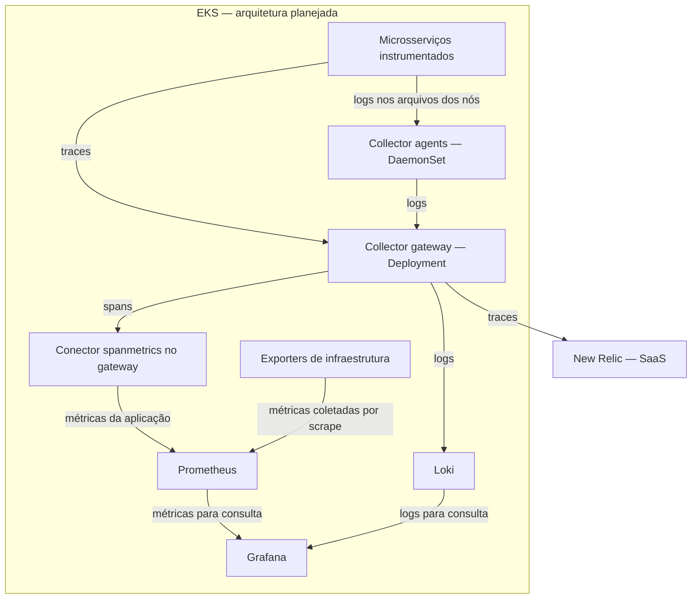
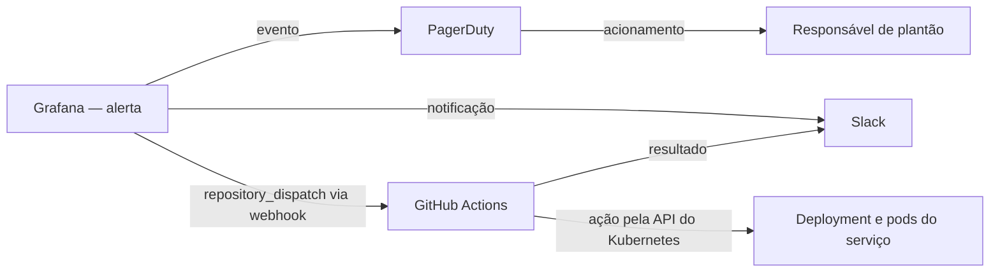
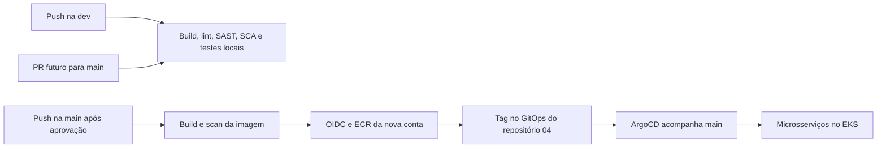

# ToggleMaster — Tech Challenge Fase 4

O ToggleMaster é uma plataforma de feature flags composta por cinco microsserviços. A Fase 4 acrescenta observabilidade e resposta a incidentes à base de Terraform, CI/CD e GitOps construída na Fase 3.

**Última atualização: 2026-10-27, Codex.** Base importada e instrumentação local dos cinco serviços aprovadas: 19 spans correlacionados, dependências PostgreSQL/Redis/SQS/DynamoDB e logs JSON. Regressão funcional, 13 testes Go principais (mais oito subtestes) e 20 testes Python nas imagens passaram. Requisitos, guias e materiais preservados. New Relic, nova conta/backend AWS, implantação no cluster e automação de incidentes continuam pendentes. Os diagramas do EKS representam a arquitetura planejada; nenhum recurso AWS foi consultado ou implantado nesta execução.

Repositório: [fiap-devops-arqcloud-2026/tech-challenge-04](https://github.com/fiap-devops-arqcloud-2026/tech-challenge-04). A base importada é o commit [6100879 da Fase 3](https://github.com/fiap-devops-arqcloud-2026/tech-challenge-03/commit/61008794090f582c098e2edc42041339c556f14c), com histórico preservado. O repositório 03 não foi alterado.

## Requisitos, estudos e situação da entrega

- [Requisitos oficiais mapeados](docs/requisitos/README.md): 42 obrigatórios, 2 opções/preferências chamadas de bônus e 4 sugestões, com evidências por página. O PDF não promete pontos extras.
- [Requisitos em HTML](docs/requisitos/REQUISITOS.html): leitura local e navegação pelos selos dos guias.
- [Enunciado da Fase 4](POSTECH%20-%20Tech%20Challenge%20-%20Fase%204.pdf).
- [Plano de ação e arquitetura, com seis diagramas](00_COLAB_IA/02_TRABALHO/PLANO_E_ARQUITETURA_FASE4_2026-09-23_v02.html): referência técnica; calendário e alguns pontos anteriores à importação precisam de revisão.
- [Conferência da cobertura dos 42 obrigatórios](00_COLAB_IA/02_TRABALHO/CONFERENCIA_PLANO_FASE4_2026-10-21_v01.md): etapas previstas e critérios de aceite que ainda precisam de detalhamento.
- [Pendências e estado atual](00_COLAB_IA/PENDENCIAS_E_PROXIMOS_PASSOS.md): E0 parcial, E1 local concluída e exportação APM/etapas de cluster pendentes.
- [Welcome](docs/aulas-fiap/00.Welcome%20to%20Observabilidade%20e%20Monitoramento/GUIA-ESTUDO-Welcome-to-Observabilidade-e-Monitoramento.html).
- [Observabilidade e Monitoramento](docs/aulas-fiap/01.Observabilidade%20e%20Monitoramento/GUIA-ESTUDO-Observabilidade-e-Monitoramento.html).
- [Monitoramento Opensource](docs/aulas-fiap/02.Monitoramento%20Opensource/GUIA-ESTUDO-Monitoramento-Opensource.html).
- [APM](docs/aulas-fiap/03.APM/GUIA-ESTUDO-APM.html).
- [Automação de incidentes](docs/aulas-fiap/04.Automa%C3%A7%C3%A3o%20de%20incidentes/GUIA-ESTUDO-Automacao-de-incidentes.html).

Os materiais originais da Fase 4 foram mantidos. Os guias abrem diretamente no navegador. A validação estrutural e as referências não substituem evidência do sistema funcionando.

O prazo de planejamento informado pelo responsável é **2026-11-17**; essa data não consta no PDF. Vídeo de até 25 minutos e relatório PDF serão produzidos após a demonstração funcional. Ainda não há links finais de vídeo/relatório da Fase 4.

## O que foi reaproveitado e o que falta

| Área | Base importada | Trabalho da Fase 4 |
|---|---|---|
| Aplicação | auth/evaluation em Go; flag/targeting/analytics em Python | Cinco serviços instrumentados localmente; comprovar ingestão e mapa no APM |
| Local | Compose, PostgreSQL, Redis e Moto para SQS/DynamoDB | Collector e ensaio de 19 spans aprovados; exportação New Relic pendente |
| Infraestrutura | Terraform em três camadas e cluster EKS | Confirmar nova conta, orçamento/cotas e provisionar estados próprios |
| CI/CD | Build, lint, SAST, SCA e scan de imagem | Destino ajustado ao repo 04; configurar variáveis da nova conta antes de publicar |
| GitOps | ArgoCD/Kustomize e 23 objetos Kubernetes | Publicar imagens/outputs novos e adicionar observabilidade por Helm/GitOps |
| Observabilidade | Instrumentação e Collector local aprovados | Implantar stack no cluster, métricas/coleta de logs e APM New Relic |
| Incidentes | Arquitetura planejada | Alerta, PagerDuty, Slack e Self-Healing por GitHub Actions |

As escolhas New Relic, Slack e GitHub Actions foram definidas no planejamento. Os estudos e o plano não significam que esses recursos já estejam configurados.

## Tecnologias escolhidas e onde serão executadas

Decisões do projeto: [D-009, D-012 e D-014](00_COLAB_IA/DECISOES.md). A tabela descreve os papéis escolhidos nesta arquitetura, não todas as capacidades dos produtos. As obrigações da FIAP e suas evidências continuam em [Requisitos](docs/requisitos/README.md).

APM significa *Application Performance Monitoring*: monitoramento do desempenho das aplicações.

| Tecnologia | Papel no projeto e caso de uso | Local previsto |
|---|---|---|
| OpenTelemetry (OTel) | Bibliotecas para instrumentar as aplicações, gerar telemetria e propagar o contexto das operações | Dentro dos contêineres dos microsserviços |
| OTel Collector | Receber, processar e exportar telemetria; concentrar o encaminhamento para os diferentes destinos | Pods próprios no EKS: agents e gateway |
| Prometheus | Armazenar e consultar métricas ao longo do tempo; investigar taxa de erros, requisições e uso de recursos | Dentro do cluster |
| Loki | Centralizar, armazenar e consultar logs; investigar eventos de vários pods num mesmo período | Dentro do cluster |
| Grafana | Consultar Prometheus/Loki, exibir dashboards e avaliar a regra de alerta | Dentro do cluster |
| New Relic | APM e tracing distribuído; investigar uma requisição lenta e visualizar dependências no Service Map | SaaS externo ao cluster |
| PagerDuty | Abrir/gerenciar incidentes e acionar responsáveis conforme políticas de plantão e escalonamento | SaaS externo ao cluster |
| Slack | Comunicar o incidente e o resultado da tentativa de mitigação | Serviço externo ao cluster |
| GitHub Actions | CI/CD e futura automação de Self-Healing, disparada por `repository_dispatch` | Runners do GitHub, fora do cluster neste plano |
| Terraform, EKS e ArgoCD | Provisionar a infraestrutura e reconciliar os manifests/charts versionados por GitOps | Terraform executado pelo operador; EKS na AWS; ArgoCD dentro do cluster |

O New Relic também oferece métricas, logs, dashboards e alertas; seu foco em APM/traces aqui é uma escolha do projeto. O Collector trata o transporte/processamento da telemetria; o histórico consultável fica nos backends. PagerDuty gerencia o atendimento humano, enquanto a tentativa de reinício será executada pelo GitHub Actions.

## Métricas, logs e traces

Telemetria são dados sobre o comportamento da aplicação e da infraestrutura. Os exemplos abaixo são didáticos, não resultados medidos nem limites definidos para o alerta.

| Sinal | O que representa | Pergunta que ajuda a responder | Exemplo ilustrativo |
|---|---|---|---|
| Métrica | Medição numérica ao longo do tempo | Quanto? Com que frequência? | CPU em 85%, 120 requisições/s, 8% de erros |
| Log | Registro de um evento, com data/hora e contexto | O que aconteceu naquele momento? | Mensagem de timeout ao consultar o banco |
| Trace | Caminho de uma execução, relacionando suas operações e durações | Onde a execução demorou ou falhou? | `evaluation → flag → banco` |

Cada operação de um trace é um **span**: receber uma chamada HTTP, consultar Redis ou executar uma consulta no banco. A propagação do contexto associa as operações à mesma execução. Incluir o identificador do trace nos logs permite correlacionar os eventos com essa execução; isso depende da instrumentação/configuração.

Uma métrica pode indicar aumento de latência, um trace localizar a operação mais demorada e um log trazer o detalhe do erro. O percurso depende do caminho realmente executado: um acerto no cache evita chamadas a outros serviços. SQS e analytics participam de um fluxo assíncrono; a correlação com a requisição exige propagar o contexto pela mensagem. A resposta HTTP não aguarda todo o processamento analítico.

## Pods, nós e distribuição do Collector

| Conceito | Significado e aplicação neste projeto |
|---|---|
| Contêiner | Ambiente que executa um processo e suas dependências, como o servidor do `flag-service` |
| Pod | Unidade de execução do Kubernetes com um ou mais contêineres no mesmo nó; eles compartilham a rede do Pod e podem compartilhar volumes configurados |
| Nó de trabalho (worker) | Máquina que executa os pods; no desenho com EKS, uma instância EC2 pode hospedar vários pods |
| Agent | Papel local do Collector: ler os arquivos de logs dos contêineres daquele nó e encaminhá-los ao gateway |
| DaemonSet | Recurso que mantém um pod em cada nó elegível; será usado pelos agents |
| Gateway | Papel central de recepção/processamento do Collector; recebe logs dos agents e traces das aplicações e os encaminha aos backends |
| Deployment | Recurso que gerencia a quantidade desejada de réplicas e as atualizações dos pods; será usado pelo gateway |

Agent e gateway são dois papéis do mesmo software Collector, com configurações diferentes. O agent não precisa ser repetido por microsserviço: um agent coleta os logs dos contêineres do nó. O gateway pode compartilhar um worker com outros pods; centralização não exige máquina dedicada nem uma única réplica.

O plano propõe **três workers**, mas as réplicas do gateway ainda não estão definidas. Em situação estável, a contagem prevista é **nós elegíveis para o DaemonSet + réplicas do gateway**. Exemplos condicionais: três agents e um gateway totalizam quatro pods do Collector; três agents e dois gateways totalizam cinco. São exemplos de dimensionamento, sem contar os pods das aplicações/outras ferramentas, e não uma configuração já implantada.

## Arquitetura planejada de observabilidade e resposta

Este é o desenho de implantação da Fase 4 no EKS, ainda pendente. O ensaio local de traces está implementado e descrito abaixo:



O Collector será configurado com **receivers → processors → exporters**: receber, tratar e enviar. Os agents coletam logs locais; o gateway agrupa/processa e roteia os dados. O `spanmetrics` transforma informações dos spans em métricas da aplicação e é um componente do gateway, sem pod próprio. As métricas de infraestrutura, como CPU/memória, serão coletadas diretamente pelo Prometheus nos exporters. Assim, nem toda métrica de infraestrutura passa pelo Collector.

No Grafana, o dashboard previsto reúne recursos do cluster, taxa de requisições e logs. No New Relic, a investigação se concentra nos traces e no mapa de serviços. A regra do Grafana notificará PagerDuty/Slack e acionará o workflow corretivo; janela, limiar, cenário de falha e alvo do reinício ainda serão definidos/validados.

O acionamento humano e a tentativa automática de correção serão caminhos complementares:



Exemplo didático do ciclo: uma falha no `flag` produz erros observáveis; o Grafana detecta a condição configurada; PagerDuty abre o incidente e aciona o responsável; Slack recebe a comunicação; GitHub Actions tenta a mitigação autorizada e verifica o resultado. O responsável pode usar métricas, traces e logs para investigar a causa. Um reinício pode resolver uma falha transitória do processo, mas não garante recuperar uma dependência indisponível.

As integrações de incidentes, o dashboard e a automação ainda não existem na configuração importada. E0–E7 e as lacunas de aceite estão no [plano](00_COLAB_IA/02_TRABALHO/PLANO_E_ARQUITETURA_FASE4_2026-09-23_v02.html) e na [conferência de cobertura](00_COLAB_IA/02_TRABALHO/CONFERENCIA_PLANO_FASE4_2026-10-21_v01.md); o [backlog](00_COLAB_IA/PENDENCIAS_E_PROXIMOS_PASSOS.md) registra o estado de execução atual.

## Serviços e arquitetura da base

| Serviço | Porta local | Responsabilidade |
|---|---|---|
| auth-service | 8001 | Chaves e autenticação de serviços |
| flag-service | 8002 | Cadastro de feature flags |
| targeting-service | 8003 | Regras de segmentação |
| evaluation-service | 8004 | Avaliação de flags e envio de eventos |
| analytics-service | 8005 | Consumo de eventos e persistência analítica |

O diagrama seguinte descreve o fluxo de publicação preparado na importação, complementar à arquitetura de observabilidade acima.



O diagrama descreve o fluxo preparado, não uma execução remota já comprovada. O trabalho atual fica na **dev**. A main não recebeu esta importação, e não foi aberto PR nem feito push. Publicação de imagens e atualização automática de tags continuam reservadas a push na main; dev/PR validam código sem autenticar na AWS.

## Executar e validar localmente

Pré-requisitos: Docker com engine Linux ativo; para o teste automatizado, Bash e Python 3. O teste usa somente valores fictícios do `.env.example` e Moto local, sem credenciais ou recursos AWS.

```bash
# Constrói os contêineres, aguarda health checks e testa o fluxo dos cinco serviços.
bash scripts/test-compose.sh
```

A instrumentação local pode ser verificada com o Collector, mantendo os três arquivos Compose durante toda a execução:

```bash
bash scripts/test-observability.sh
```

Resultado de **2026-10-27**: 19 spans nos cinco serviços; PostgreSQL de auth/flag/targeting, Redis, SQS e DynamoDB; contexto HTTP/SQS e logs correlacionados aprovados. Sete eventos da regressão e um da prova controlada conferidos. Health e sanitização de atributos testados. O laboratório desta execução foi encerrado; as evidências locais foram preservadas. Não houve validação New Relic.

- [Runbook da observabilidade local](observability/README.md).
- [Relatório do passo 1 — integração e revalidação](00_COLAB_IA/02_TRABALHO/RELATORIO_PASSO1_REVALIDACAO_2026-10-27_v01.md).
- [Relatório do passo 2 — instrumentação e prova local](00_COLAB_IA/02_TRABALHO/RELATORIO_PASSO2_OBSERVABILIDADE_LOCAL_2026-10-27_v01.md).
- [Resultado consolidado](00_COLAB_IA/02_TRABALHO/RESULTADO_PASSOS_LOCAIS_2026-10-27_v01.json).

O projeto Compose padrão do teste é `tc04-integration`, separado de outros laboratórios. O script não remove o ambiente ao terminar. Para remover somente os contêineres e volumes descartáveis criados por esse teste, use a mesma identidade de projeto:

```bash
# Define a identidade exclusiva do laboratório que será encerrado.
export COMPOSE_PROJECT_NAME=tc04-integration
# Encerra somente esse projeto de teste e seus volumes descartáveis.
docker compose --env-file .env.example -f docker-compose.yaml -f docker-compose.integration.yaml -f docker-compose.otel.yaml down -v --remove-orphans
```

Para checagens locais de sintaxe, build e composição:

```bash
# Verifica padrões de segredos, Terraform sem backend, manifests e Grafana, testes do self-healing e build/sintaxe dos serviços.
bash scripts/validate-all.sh
```

Leia a saída: a ausência de ferramenta é informada pelo script e limita a verificação. Há testes Go/Python de contexto, contratos e erros; o ensaio em Compose verifica a interação real dos serviços e o novo gate exige spans PostgreSQL nos três serviços consumidores desse banco. Nenhum desses comandos comprova implantação na AWS.

## CI/CD e a nova conta AWS

Os cinco workflows de serviços usam dois workflows reutilizáveis. Build, lint, SAST e SCA não dependem de conta AWS. Terraform Check, GitOps Check e Compose Integration também rodam em push na dev. Em pull request, cada serviço alterado também tem a imagem construída e escaneada pelo Trivy, sem publicar. Os scans mantêm a política importada de bloquear vulnerabilidades CRITICAL.

Quando a conta estiver pronta, configurar estas **repository variables** no repo 04:

| Variável | Conteúdo |
|---|---|
| `AWS_REGION` | Região confirmada; enquanto ausente, CI usa o padrão de planejamento `us-east-2` |
| `ECR_REGISTRY` | Endereço real do ECR da nova conta |
| `AWS_ROLE_ARN` | Role real com confiança OIDC autorizada ao repositório 04 |

O pipeline de publicação recusa variáveis ausentes ou destinos incoerentes antes de autenticar na AWS ou enviar imagens. Nenhuma chave AWS estática deve ser versionada.

## Terraform e ArgoCD: configuração pendente

Consulte [Terraform da Fase 4](terraform/README.md) e [GitOps da Fase 4](gitops/README.md). As camadas usam chaves próprias `phase4/prod/base.tfstate`, `phase4/prod/cluster.tfstate` e `phase4/prod/k8s.tfstate`, backend parcial e identificação obrigatória da conta esperada. Não reutilizar estado da conta anterior como estado de uma conta nova.

O backend guarda o **state**, não o código `.tf`: código fica no Git; o snapshot relaciona endereços Terraform a IDs/atributos dos recursos. O backend S3 armazena esse snapshot e seu lock; Terraform continua executando no operador/runner. São três camadas do mesmo ambiente `prod`, com estados próprios, não três ambientes criados pela branch `dev`. Bucket/região/identidade reais precisam ser confirmados; ausência dos arquivos locais não prova inexistência de estado remoto.

[Relatório aprofundado do Terraform/backend](00_COLAB_IA/02_TRABALHO/RELATORIO_TERRAFORM_BACKEND_2026-10-22_v01.md), reconferido na [revisão de 2026-10-27](00_COLAB_IA/02_TRABALHO/REVISAO_TERRAFORM_E_OTEL_2026-10-27_v01.md): 40 arquivos .tf, sete módulos locais, oito chamadas e três raízes. State pode conter senhas; `sensitive` não as remove. O guard do provider AWS não protege automaticamente backend, remote state ou autenticação da CLI.

O ArgoCD está preparado para `https://github.com/fiap-devops-arqcloud-2026/tech-challenge-04.git`. A main é seu destino futuro; trabalhar localmente na dev não sincroniza um cluster. Imagens, IRSA e endpoints no overlay usam marcadores intencionais de conta pendente e devem ser substituídos por outputs confirmados antes de habilitar implantação. Tipos/tamanhos, versões, cotas e custos herdados precisam de revisão antes da subida.

## Documentação histórica da base

[Arquitetura](docs/ARQUITETURA.md), [guia de reprodução](docs/GUIA_DE_REPRODUCAO.md), [relatório anterior](docs/RELATORIO_DE_ENTREGA.md) e materiais da Fase 3 foram preservados para rastreabilidade. Links de evidências antigos continuam apontando ao repo 03, onde os eventos ocorreram; não são provas de execução da Fase 4 nem parâmetros para a conta nova. A configuração vigente do destino é a deste README, de `terraform/README.md` e de `gitops/README.md`.

## Fontes das explicações técnicas

Conceitos conferidos na documentação oficial em **2026-10-22**, além do plano e das decisões locais. Estas fontes explicam as ferramentas; não acrescentam exigências ao enunciado da FIAP.

- [OpenTelemetry: conceitos, logs e traces](https://opentelemetry.io/docs/concepts/observability-primer/), [Collector](https://opentelemetry.io/docs/collector/), [agent](https://opentelemetry.io/docs/collector/deploy/agent/) e [gateway](https://opentelemetry.io/docs/collector/deploy/gateway/).
- [Kubernetes: Pods](https://kubernetes.io/docs/concepts/workloads/pods/), [DaemonSet](https://kubernetes.io/docs/concepts/workloads/controllers/daemonset/) e [Deployment](https://kubernetes.io/docs/concepts/workloads/controllers/deployment/).
- [Prometheus](https://prometheus.io/docs/introduction/overview/), [fontes de dados do Grafana](https://grafana.com/docs/grafana/latest/datasources/) e [Loki](https://grafana.com/docs/loki/latest/get-started/overview/).
- [OpenTelemetry e New Relic](https://docs.newrelic.com/docs/opentelemetry/opentelemetry-introduction/) e [gestão de incidentes do PagerDuty](https://docs.pagerduty.com/incident-management/incidents/overview).
