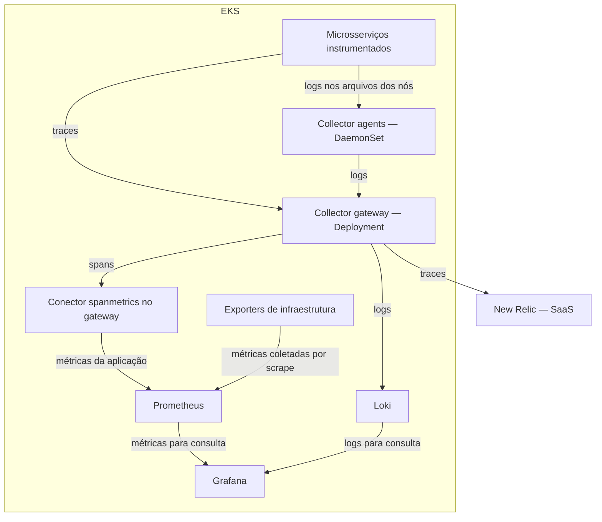
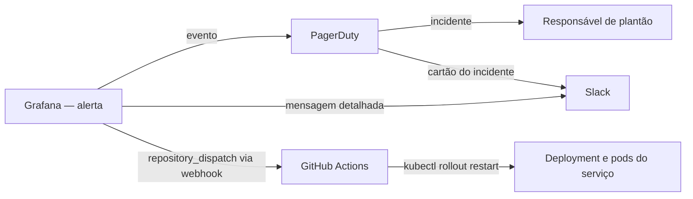
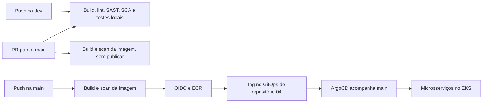

<div align="center">

# 🚦 ToggleMaster
### Tech Challenge · Fase 4
**Observabilidade • GitOps • Resposta a incidentes • Self-healing**

[🎬 Gravar o vídeo](docs/gravacao/README.md) · [📄 Relatório](docs/relatorio/README.md) · [📸 Evidências](docs/evidencias/README.md) · [🚦 Entender o CI/CD](docs/CI-CD.md)

</div>

O ToggleMaster controla funcionalidades por **feature flags**, usando cinco microsserviços. Esta fase adiciona visibilidade do sistema e resposta automática a falhas à base de Terraform, Kubernetes e CI/CD.

> **Documentação atualizada em 2026-11-10. Evidência de execução: 2026-11-09.** O EKS tinha dois nós `Ready`, cinco serviços em execução e seis Applications `Synced/Healthy`. O ensaio real percorreu **503 → Firing → PagerDuty/Slack → GitHub Actions → restart automático → HTTP 200**. Grafana e trace de 19 spans foram capturados. [Execução automática](https://github.com/fiap-devops-arqcloud-2026/tech-challenge-04/actions/runs/42679005683) · [Evidências e limites](docs/evidencias/README.md). O vídeo ainda precisa ser gravado e seu link incluído no relatório.

## 🧭 Comece por aqui

| Quero… | Abrir |
|---|---|
| Entender o desenho | [Arquitetura abaixo](#arquitetura) · [referência técnica completa](docs/ARQUITETURA.md) |
| Saber o que a FIAP pede | [Requisitos com páginas do enunciado](docs/requisitos/README.md) |
| Preparar a gravação | [Roteiro e falas](docs/gravacao/README.md) · [comandos](docs/gravacao/COMANDOS.md) · [passo a passo por cena](docs/gravacao/PASSO_A_PASSO_POR_CENA.md) |
| Ler o roteiro fora do navegador | [PDF](docs/gravacao/ROTEIRO_GRAVACAO_2026-11-10_v02.pdf) · [PowerPoint](docs/gravacao/ROTEIRO_GRAVACAO_2026-11-10_v02.pptx) |
| Entender uma execução do Actions | [Guia dos workflows](docs/CI-CD.md) |
| Reproduzir e conferir o ambiente | [Guia da Fase 4](docs/GUIA_DE_REPRODUCAO.md) · [validação local abaixo](#validacao-local) |
| Ver infraestrutura e deploy | [Terraform](terraform/README.md) · [GitOps](gitops/README.md) |
| Entender métricas, logs, traces, pods e agents | [Conceitos explicados](docs/CONCEITOS_OBSERVABILIDADE.md) |

## 🎯 O que a entrega precisa demonstrar

1. **Base funcionando:** cinco serviços, IaC, CI/CD com DevSecOps e Kubernetes com GitOps.
2. **Observabilidade:** Prometheus, Loki, Grafana e Collector; dashboard com recursos, requisições e logs.
3. **APM:** instrumentação, mapa dos cinco serviços e trace de uma requisição ao evaluation-service.
4. **Resposta ativa:** falha proposital → alerta Firing → incidente → ChatOps → correção automática.
5. **Entrega:** código, vídeo de até **25 minutos** e PDF com identificação, links, quatro prints e justificativas.

Fonte: [enunciado FIAP](POSTECH%20-%20Tech%20Challenge%20-%20Fase%204.pdf), p. 2–6. A página 5 exige demonstração clara; configuração sozinha não comprova funcionamento. As duas alternativas chamadas de “bônus” na matriz não têm promessa de pontos adicionais.

<a id="arquitetura"></a>

## 🏗️ Arquitetura de observabilidade e resposta

Este é o desenho da Fase 4 no EKS, usado no ensaio integrado de 2026-11-09. A reprodução local também está descrita mais abaixo:



O Collector é configurado com **receivers → processors → exporters**: receber, tratar e enviar. Os agents coletam logs locais; o gateway agrupa, processa e roteia os dados. O `spanmetrics` transforma informações dos spans em métricas da aplicação e é um componente do gateway, sem pod próprio. As métricas de infraestrutura, como CPU e memória, são coletadas diretamente pelo Prometheus nos exporters. Assim, nem toda métrica de infraestrutura passa pelo Collector.

No Grafana, o [dashboard](gitops/observability/grafana/dashboards/togglemaster-overview.json) reúne erros e requisições por serviço, latência, CPU e memória por nó e por pod, e logs do Loki. No New Relic, a investigação se concentra nos traces e no mapa de serviços. A regra `FlagService5xxAlto` dispara quando os erros 5xx do flag-service passam de 10% por 1 minuto.

O acionamento humano e a tentativa automática de correção são caminhos complementares:



O ciclo executado no ensaio de 2026-11-09 e previsto para a gravação: uma falha controlada no `flag-service` (`POST /admin/fault`) faz as rotas de flags responderem 503, enquanto o `/health` continua saudável; o Grafana detecta a taxa de erro; o PagerDuty abre o incidente; o Slack recebe a comunicação; o GitHub Actions reinicia o Deployment, com lista de serviços permitidos e intervalo mínimo entre reinícios. O processo novo nasce sem a falha, os erros param e o alerta se resolve. Um reinício resolve uma falha transitória do processo, mas não recupera uma dependência indisponível.


## 🧩 Cinco serviços, um fluxo de entrega

| Serviço | Porta local | Responsabilidade |
|---|---|---|
| auth-service | 8001 | Chaves e autenticação de serviços |
| flag-service | 8002 | Cadastro de feature flags |
| targeting-service | 8003 | Regras de segmentação |
| evaluation-service | 8004 | Avaliação de flags e envio de eventos |
| analytics-service | 8005 | Consumo de eventos e persistência analítica |

O diagrama seguinte descreve o fluxo de publicação, complementar à arquitetura de observabilidade acima.



O trabalho do dia a dia fica na **dev**. Publicação de imagens e atualização automática de tags só acontecem no push na main; dev e PR validam o código sem autenticar na AWS.


## 🔎 Do requisito ao código

| Requisito | Onde está |
|---|---|
| Prometheus, Loki e Grafana por Helm, no repositório GitOps | [`gitops/observability/applications`](gitops/observability/applications) e [`values`](gitops/observability/values) |
| Dashboard customizado: recursos do cluster, requisições e logs | [`togglemaster-overview.json`](gitops/observability/grafana/dashboards/togglemaster-overview.json) |
| OTel Collector como peça central | [`otel-gateway.yaml`](gitops/observability/values/otel-gateway.yaml) e [`otel-agent.yaml`](gitops/observability/values/otel-agent.yaml) |
| APM comercial e instrumentação | New Relic, pelo gateway; `telemetry.py` e `telemetry.go` em cada [serviço](services) |
| Alerta inteligente | [`rules.yaml`](gitops/observability/grafana/alerting/rules.yaml): 5xx do flag-service acima de 10% por 1 minuto |
| PagerDuty e Slack | [`contactpoints.yaml`](gitops/observability/grafana/alerting/contactpoints.yaml) e [`policies.yaml`](gitops/observability/grafana/alerting/policies.yaml) |
| Self-healing | [`self-healing.yml`](.github/workflows/self-healing.yml), [`restart.sh`](scripts/self-healing/restart.sh) e [`self-healing-rbac.yaml`](gitops/base/self-healing-rbac.yaml) |


## 🛠️ Ferramentas e responsabilidades

A tabela descreve os papéis escolhidos nesta arquitetura, não todas as capacidades dos produtos. As obrigações da FIAP e suas evidências continuam em [Requisitos](docs/requisitos/README.md).

APM significa *Application Performance Monitoring*: monitoramento do desempenho das aplicações.

| Tecnologia | Papel no projeto e caso de uso | Onde roda |
|---|---|---|
| OpenTelemetry (OTel) | Bibliotecas para instrumentar as aplicações, gerar telemetria e propagar o contexto das operações | Dentro dos contêineres dos microsserviços |
| OTel Collector | Receber, processar e exportar telemetria; concentrar o encaminhamento para os diferentes destinos | Pods próprios no EKS: agents e gateway |
| Prometheus | Armazenar e consultar métricas ao longo do tempo; investigar taxa de erros, requisições e uso de recursos | Dentro do cluster |
| Loki | Centralizar, armazenar e consultar logs; investigar eventos de vários pods num mesmo período | Dentro do cluster |
| Grafana | Consultar Prometheus/Loki, exibir dashboards e avaliar a regra de alerta | Dentro do cluster |
| New Relic | APM e tracing distribuído; investigar uma requisição lenta e visualizar dependências no Service Map | SaaS externo ao cluster |
| PagerDuty | Abrir/gerenciar incidentes e acionar responsáveis conforme políticas de plantão e escalonamento | SaaS externo ao cluster |
| Slack | Comunicar o incidente e o resultado da tentativa de mitigação | Serviço externo ao cluster |
| GitHub Actions | CI/CD e automação de self-healing, disparada por `repository_dispatch` | Runners do GitHub, fora do cluster |
| Terraform, EKS e ArgoCD | Provisionar a infraestrutura e reconciliar os manifests/charts versionados por GitOps | Terraform executado pelo operador; EKS na AWS; ArgoCD dentro do cluster |

O New Relic também oferece métricas, logs, dashboards e alertas; seu foco em APM/traces aqui é uma escolha do projeto. O Collector trata o transporte/processamento da telemetria; o histórico consultável fica nos backends. PagerDuty gerencia o atendimento humano, enquanto a tentativa de reinício é executada pelo GitHub Actions.


<a id="validacao-local"></a>

## 🧪 Executar e validar localmente

Pré-requisitos: Docker com engine Linux ativo; para o teste automatizado, Bash e Python 3. O teste usa somente valores fictícios do `.env.example` e Moto local, sem credenciais ou recursos AWS.

```bash
# Constrói os contêineres, aguarda health checks e testa o fluxo dos cinco serviços.
bash scripts/test-compose.sh
```

A instrumentação local pode ser verificada com o Collector, mantendo os três arquivos Compose durante toda a execução:

```bash
bash scripts/test-observability.sh
```

Resultado de **2026-10-27**: 19 spans nos cinco serviços; PostgreSQL de auth/flag/targeting, Redis, SQS e DynamoDB; contexto HTTP/SQS e logs correlacionados aprovados. Sete eventos da regressão e um da prova controlada conferidos. Health e sanitização de atributos testados.

- [Runbook da observabilidade local](observability/README.md), que também descreve a exportação dos traces para o New Relic (`scripts/test-observability-newrelic.sh`).

O projeto Compose padrão do teste é `tc04-integration`, separado de outros laboratórios. O script não remove o ambiente ao terminar. Para remover somente os contêineres e volumes descartáveis criados por esse teste, use a mesma identidade de projeto:

```bash
# Define a identidade exclusiva do laboratório que será encerrado.
export COMPOSE_PROJECT_NAME=tc04-integration
# Encerra somente esse projeto de teste e seus volumes descartáveis.
docker compose --env-file .env.example -f docker-compose.yaml -f docker-compose.integration.yaml -f docker-compose.otel.yaml down -v --remove-orphans
```

Para checagens locais de sintaxe, build e composição:

```bash
# Verifica padrões de segredos, Terraform sem backend, manifests e Grafana, testes do self-healing e build/sintaxe dos serviços.
bash scripts/validate-all.sh
```

Leia a saída: a ausência de ferramenta é informada pelo script e limita a verificação. Há testes Go/Python de contexto, contratos e erros; o ensaio em Compose verifica a interação real dos serviços e o novo gate exige spans PostgreSQL nos três serviços consumidores desse banco. Nenhum desses comandos comprova implantação na AWS.

## CI/CD

Os cinco workflows de serviços usam dois workflows reutilizáveis. Build, lint, SAST e SCA não dependem de conta AWS. Terraform Check, GitOps Check e Compose Integration também rodam em push na dev. Em pull request, cada serviço alterado também tem a imagem construída e escaneada pelo Trivy, sem publicar. Os scans bloqueiam vulnerabilidades CRITICAL.

Publicar e reiniciar serviços exige estas **repository variables**:

| Variável | Conteúdo |
|---|---|
| `AWS_REGION` | Região do projeto: `us-east-2` |
| `ECR_REGISTRY` | Endereço do ECR da conta |
| `AWS_ROLE_ARN` | Role do CI, com confiança OIDC restrita à `main` deste repositório |
| `AWS_SELF_HEALING_ROLE_ARN` | Role do self-healing, com a mesma confiança |
| `EKS_CLUSTER_NAME` | Nome do cluster: `togglemaster` |

O pipeline de publicação recusa variáveis ausentes ou destinos incoerentes antes de autenticar na AWS ou enviar imagens. Nenhuma chave AWS estática é versionada.

## Terraform e ArgoCD

Consulte [Terraform da Fase 4](terraform/README.md) e [GitOps da Fase 4](gitops/README.md). As camadas usam chaves próprias `phase4/prod/base.tfstate`, `phase4/prod/cluster.tfstate` e `phase4/prod/k8s.tfstate`, backend parcial e identificação obrigatória da conta esperada.

O backend guarda o **state**, não o código `.tf`: o código fica no Git, e o state relaciona endereços Terraform a IDs e atributos dos recursos. O S3 armazena esse snapshot e seu lock; o Terraform executa na máquina do operador. São três camadas do mesmo ambiente `prod`, com estados próprios. O state pode conter senhas; `sensitive` não as remove.

O ArgoCD acompanha a `main` de `https://github.com/fiap-devops-arqcloud-2026/tech-challenge-04.git`. Como o repositório é público, ele não precisa de credencial. Endpoints e IRSA do overlay recebem os outputs do Terraform no primeiro deploy, e as tags das imagens são gravadas pelo CI.


## 📸 Relatório e gravação

O PDF da FIAP pede quatro prints no relatório: **dashboard Grafana, trace distribuído, notificação ChatOps e execução do self-healing** (p. 6). O [índice das evidências](docs/evidencias/README.md) separa capturas existentes e itens ainda pendentes.

- [Relatório PDF e estado de fechamento](docs/relatorio/README.md).
- [Roteiro com falas, tempos e telas](docs/gravacao/README.md).
- **Vídeo:** gravação preparada para 2026-11-10; URL ainda não disponibilizada. Incluir depois de gravar e testar o acesso.
- **Antes de gravar:** conferir o Service Map global com os cinco serviços; o trace capturado não substitui essa demonstração.
- Entrada local para novos prints: `docs/evidencias/entrada-local/` (ignorada pelo Git até revisão).

## 📚 Material de estudo

[Requisitos HTML](docs/requisitos/REQUISITOS.html) e [cinco módulos de aulas/guias](docs/aulas-fiap). Os HTMLs abrem por duplo clique.

<details>
<summary>Histórico da base</summary>

A base foi importada do [commit 6100879 da Fase 3](https://github.com/fiap-devops-arqcloud-2026/tech-challenge-03/commit/61008794090f582c098e2edc42041339c556f14c), com histórico preservado. A [arquitetura](docs/ARQUITETURA.md) e o [guia de reprodução](docs/GUIA_DE_REPRODUCAO.md) foram revisados para a Fase 4 em 2026-11-10. Estados, credenciais e valores da conta anterior não foram transportados.

</details>
