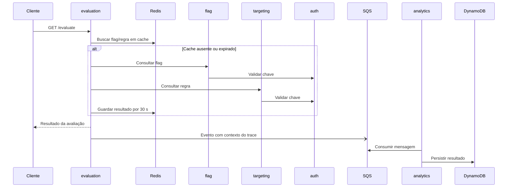
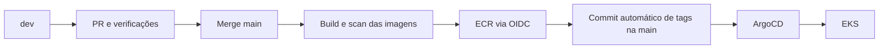
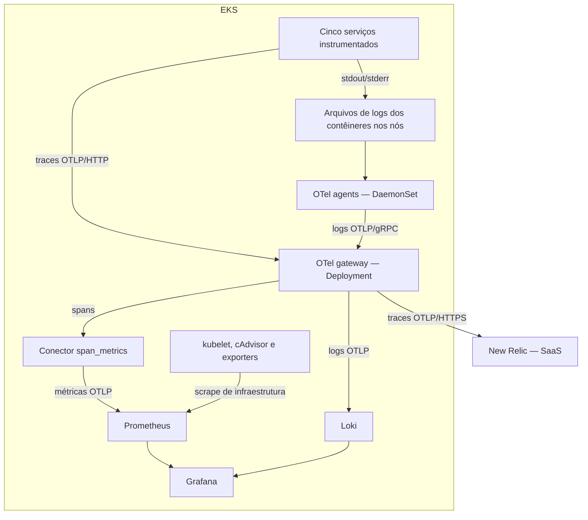
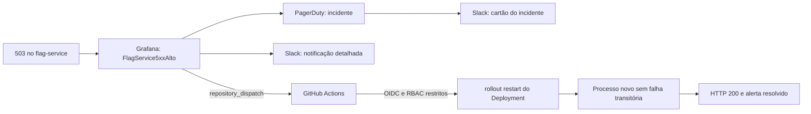

# 🏗️ Arquitetura do ToggleMaster — Fase 4

**Resumo:** cinco microsserviços no EKS, publicados por CI/CD e reconciliados pelo ArgoCD. A observabilidade combina métricas, logs e traces; um alerta pode abrir incidente, avisar no Slack e iniciar uma tentativa automática de recuperação. **Atualização: 2026-11-10.** Fontes: arquivos vinculados abaixo e [evidências do ensaio de 2026-11-09](evidencias/README.md).

## 1. Aplicação e dependências

| Serviço | Porta | Responsabilidade | Dependências |
|---|---|---|---|
| auth-service | 8001 | Criar/validar chaves de serviço | PostgreSQL no RDS |
| flag-service | 8002 | Cadastrar e consultar feature flags | auth-service e PostgreSQL no RDS |
| targeting-service | 8003 | Regras de segmentação | auth-service e PostgreSQL em StatefulSet |
| evaluation-service | 8004 | Avaliar flag e produzir evento | flag, targeting, Redis e SQS |
| analytics-service | 8005 | Consumir evento e persistir resultado | SQS e DynamoDB |

Fonte: [código dos serviços](../services), [base Kubernetes](../gitops/base) e [Terraform cluster](../terraform/cluster). Auth/evaluation usam Go; os demais usam Python. Cada Dockerfile tem estágios de build/runtime e usuário de aplicação.

O diagrama simplifica as chamadas: flag e targeting podem ser consultados em paralelo. A resposta HTTP não aguarda o processamento analítico. O contexto segue nos atributos da mensagem SQS, ligando produtor e consumidor ao trace. Cache é por **nome da flag**: trocar apenas user_id não garante um trace com todas as dependências.

## 2. Infraestrutura e estado Terraform

| Raiz | Recursos declarados | Chave no backend S3 |
|---|---|---|
| terraform/ | Rede, NAT, cinco ECR, SQS/DLQ, DynamoDB e IAM/OIDC do CI | phase4/prod/base.tfstate |
| terraform/cluster/ | EKS, dois RDS, ElastiCache Redis e IRSA | phase4/prod/cluster.tfstate |
| terraform/k8s/ | ArgoCD, Applications, StorageClass e Secrets | phase4/prod/k8s.tfstate |

O código `.tf` fica no Git. O **state** fica no backend S3 e relaciona o código aos recursos criados; há lock de estado. Cada raiz tem seu próprio backend e lê os outputs necessários das anteriores. Não transportar estados da Fase 3. Backend, tfvars, planos e credenciais locais não são versionados. [Detalhes e exemplos](../terraform/README.md).

Os valores padrão atuais do cluster são Kubernetes 1.34, dois workers `m7i-flex.large` e um ambiente `prod`. Quantidade desejada não é inventário permanente: conferir `kubectl get nodes` antes da gravação. O targeting usa PostgreSQL em StatefulSet/PVC; auth e flag usam RDS. Essa topologia é visível no código e deve ser explicada como a implementação do projeto.

## 3. GitOps e publicação

O ArgoCD acompanha a **main** do repositório [tech-challenge-04](https://github.com/fiap-devops-arqcloud-2026/tech-challenge-04), usando `gitops/overlays/prod` para a aplicação e `gitops/observability` para a stack. O acesso ao repositório público dispensa token de leitura no cluster.

Há seis Applications no desenho: `togglemaster`, `observability`, `kube-prometheus-stack`, `loki`, `otel-gateway` e `otel-agent`. As quatro últimas são aplicações filhas de observability. O ArgoCD usa o chart 7.7.23 com imagem v2.13.9. [Workflows e limites de cada teste](CI-CD.md).

Os Services são ClusterIP, sem Ingress neste laboratório. Acesso às interfaces por port-forward, iniciado antes da gravação. HPA de evaluation/analytics é configuração de escala, não prova de que ocorreu um evento de escala.

## 4. Caminho dos três sinais

- **Agents:** um pod por nó elegível, lendo arquivos locais e enriquecendo logs com metadados Kubernetes.
- **Gateway:** uma réplica configurada; recebe, processa e encaminha telemetria. Em dois nós estáveis, o desenho tem dois agents e um gateway.
- **Traces:** SDKs Go/Python → gateway → New Relic. Filtro remove `/health`; sanitização usa lista permitida de atributos antes da exportação.
- **Métricas da aplicação:** `span_metrics` transforma spans em contadores/histogramas de chamadas, erros e latência; não é um pod adicional. O Prometheus recebe essas métricas via OTLP.
- **Métricas de infraestrutura:** Prometheus faz scrape dos exporters/kubelet; elas não passam todas pelo gateway.
- **Logs:** agentes → gateway → Loki, consultado pelo Grafana. A [matriz de requisitos](requisitos/README.md#req-obr-08) registra o estado de cobertura da coleta.

Fontes: [gateway](../gitops/observability/values/otel-gateway.yaml), [agent](../gitops/observability/values/otel-agent.yaml), [charts](../gitops/observability/applications), [dashboard](../gitops/observability/grafana/dashboards/togglemaster-overview.json). [Explicação leiga dos conceitos](CONCEITOS_OBSERVABILIDADE.md).

## 5. Alerta, incidente e recuperação

A regra usa a proporção de spans HTTP SERVER com erro no flag-service, com limiar acima de **10% por 1 minuto**. O teste controlado ativa `/admin/fault` autenticado: rotas de flags passam a 503, enquanto `/health` permanece saudável. Assim, o reinício exibido pode ser atribuído à automação, não à liveness probe.

O workflow valida evento/serviço, assume role AWS por OIDC, usa RBAC limitado e respeita **600 s de cooldown** entre reinícios. Confere o rollout e registra `restarted`, `cooldown`, `refused` ou `ignored`. Apenas `restarted` com recuperação prova uma nova ação corretiva; execução manual não prova o disparo automático.

**Ensaio de 2026-11-09:** Firing às 18:59:20 UTC, restart às 18:59:39 UTC, rollout concluído às 19:00:03 UTC e HTTP 200 observado às 19:00:19 UTC; incidente PagerDuty #4 resolvido. [Execução automática](https://github.com/fiap-devops-arqcloud-2026/tech-challenge-04/actions/runs/42679005683). É evidência datada, não garantia de saúde futura.

## 6. Identidade, dados e limites

- CI usa OIDC para publicar no ECR; self-healing tem role separada. IRSA autoriza evaluation/analytics a consumir os recursos AWS necessários.
- Secrets são criados pela camada k8s, conforme [contrato](../gitops/SECRETS-CONTRATO.md); o Git contém nomes/referências, sem valores.
- Não mostrar `.env`, Secret YAML, tfvars, state ou telas de integrações na gravação. O pod `trafego` contém uma chave; não exibir seu describe ou manifesto.
- `selfHeal` do ArgoCD corrige divergência declarativa. O self-healing pedido pela FIAP é a reação ao alerta, executada pelo Actions; são mecanismos distintos.
- Restart resolve a falha transitória demonstrada, mas não garante recuperar um banco indisponível. Não anunciar autorreparo de qualquer incidente.
- O trace capturado contém os cinco serviços. O **Service Map global** foi mostrado no vídeo de 2026-11-11, e o relatório traz o mapa de entidades do trace. Esse mapa de um trace não substitui o mapa global como prova do requisito.
- A configuração é de laboratório: uma réplica de gateway e componentes sem promessa de alta disponibilidade. Não inferir gratuidade ou custo atual a partir de comentários históricos.

Para reproduzir e gravar: [guia vigente](GUIA_DE_REPRODUCAO.md), [roteiro](gravacao/README.md) e [evidências](evidencias/README.md).
