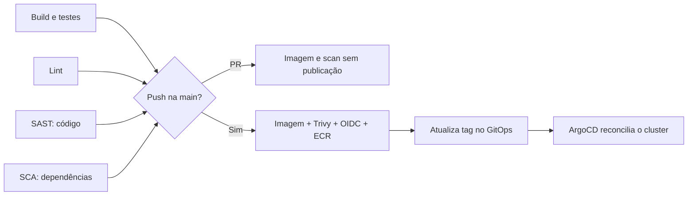

# 🚦 Entenda o GitHub Actions

**Resumo:** o CI verifica o código; a publicação gera imagens no ECR; o ArgoCD aplica a configuração do Git. O self-healing é uma automação separada que reage ao alerta. Atualizado em **2026-11-10**.

## 🧭 Qual workflow abrir?

| Workflow | O que verifica ou executa | Quando roda |
|---|---|---|
| 🔑 Auth · CI/CD | Go: build, testes, golangci-lint, gosec, Trivy | Mudança no serviço ou em seu workflow/reutilizável; push dev/main, PR e manual |
| ⚡ Evaluation · CI/CD | Mesmas verificações Go para avaliação de flags | Mesmos gatilhos, filtrados para evaluation |
| 🚩 Flags · CI/CD | Python: dependências, sintaxe, pytest quando há testes, flake8/pylint, Bandit e Trivy | Mesmos gatilhos, filtrados para flag |
| 🎯 Targeting · CI/CD | Mesmas verificações Python para regras | Mesmos gatilhos, filtrados para targeting |
| 📊 Analytics · CI/CD | Mesmas verificações Python para consumo de eventos | Mesmos gatilhos, filtrados para analytics |
| 🔍 GitOps · validação e segurança | Renderiza três bases Kustomize; valida Grafana; testa restart com kubectl simulado; procura segredos | Todo PR, push dev/main e manual |
| 🏗️ Terraform · validação e OIDC | fmt, validate das três camadas e testes do módulo iam-ci sem AWS | Mudanças Terraform/workflow; PR, push dev/main e manual |
| 🧪 Integração · cinco serviços | Build, health checks e fluxo ponta a ponta em Compose com bancos, Redis e Moto | PR/push dev/main, exceto alterações só de documentação; manual |
| 🩺 Self-healing · resposta a incidentes | Assume role via OIDC, confere allowlist/cooldown, reinicia Deployment e aguarda rollout | repository_dispatch do Grafana; manual apenas para diagnóstico |

Os arquivos `_ci-go.yml` e `_ci-python.yml` são reutilizados pelos cinco workflows de serviço; recebem `service` por `workflow_call`. Não são dois serviços adicionais.

## 🔬 Como ler o grafo de um serviço

- **Dev:** build, testes, lint, SAST e SCA.
- **PR:** acrescenta build e scan da imagem, sem publicar no ECR.
- **Push na main:** publica a imagem após as verificações e atualiza a tag.
- **Execução manual de CI:** verifica; não substitui o push na main para publicar.

SAST procura padrões inseguros no código (gosec/Bandit). SCA procura vulnerabilidades nas dependências (Trivy fs). O scan de imagem verifica os pacotes da imagem construída. Os níveis e exceções efetivos estão nos reutilizáveis e em `.trivyignore`; um run verde não significa ausência de toda vulnerabilidade.

## 🩺 O que demonstra self-healing

No run, confira **evento `repository_dispatch`**, serviço, passo **Reiniciar com allowlist e cooldown** e resultado **restarted**. `cooldown` é uma proteção correta, mas não comprova um novo reinício. Um disparo manual não prova a cadeia automática. O script aguarda `rollout status`; depois confirme HTTP 200 e alerta normal no Grafana.

**Evidência real (2026-11-09):** a [execução 42679005683](https://github.com/fiap-devops-arqcloud-2026/tech-challenge-04/actions/runs/42679005683) recebeu `repository_dispatch`, reiniciou o flag-service e concluiu o rollout. O tráfego voltou a HTTP 200 e o incidente foi resolvido; [prints e horários](evidencias/README.md).

O `GitOps Check` testa o script com um kubectl simulado. Esse teste não comprova conectividade, IAM, RBAC ou recuperação no EKS. Terraform Check também não executa apply nem valida o ambiente funcionando.

## 🛡️ Publicação e identidade

Humano: **dev → PR aprovado nos checks → merge main**. Robô: commit de tags direto na main com `GITHUB_TOKEN` e `[skip ci]`. Sincronize a dev com a main antes de editar novamente. Nunca apague a dev ao fazer merge.

Variables: `AWS_REGION`, `AWS_ROLE_ARN`, `ECR_REGISTRY`, `AWS_SELF_HEALING_ROLE_ARN`, `EKS_CLUSTER_NAME`. OIDC entrega credenciais temporárias à execução; não use chaves AWS estáticas no workflow. O token do dispatch fica no Secret usado pelo Grafana, não no YAML.

**Fonte:** [workflows](../.github/workflows), [testes locais](../scripts), [GitOps](../gitops/README.md). Nomes visuais foram melhorados; gatilhos, IDs de jobs, permissões e comandos foram preservados.
